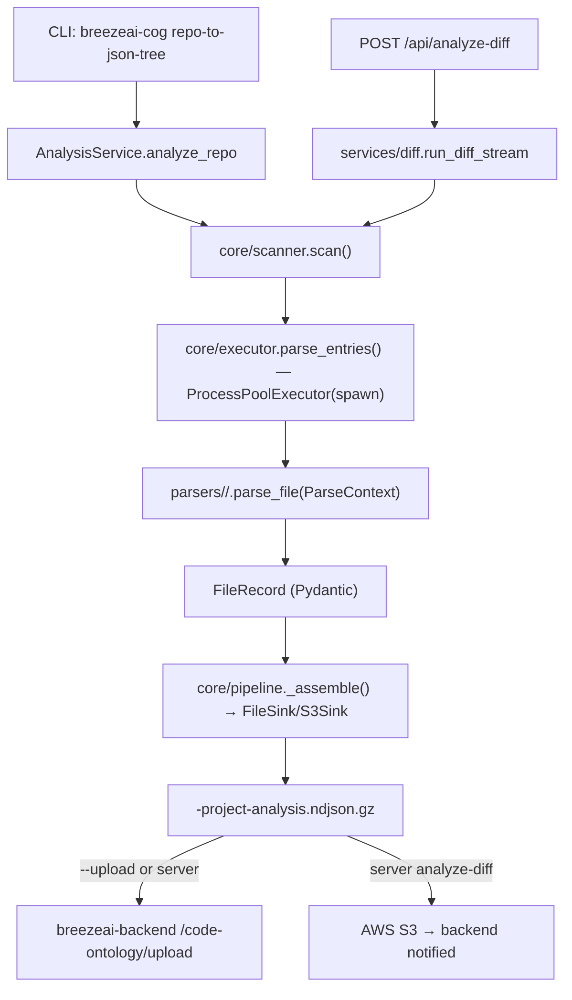

Scope: Purpose, runtime stack, external dependencies, request-flow diagram.

## Purpose

`breezeai-cog` (Part C of the Breeze platform) converts a source repository into a gzipped NDJSON file called the **capture contract** — a structured, language-neutral representation of the code-ontology (files, classes, functions, statements). The backend ingests this file to build its Neo4j code-graph.

Two interfaces:
- **CLI** (`breezeai-cog repo-to-json-tree`) — used by the `breeze:onboard-repository` skill and CI pipelines; supports local repos and `--upload` to the backend.
- **HTTP service** (`breezeai-cog serve`) — called by `breezeai-backend` for incremental diff analysis, SQL/NoSQL schema ingestion, and SCM provider operations.

## Runtime stack

| Component | Version / notes |
|---|---|
| Python | ≥3.11 required |
| Package manager | `uv` (PEP 517; `pyproject.toml`) |
| CLI framework | `typer ≥0.12` |
| HTTP server | `fastapi ≥0.110` + `uvicorn ≥0.29` (optional `server` extra) |
| Parsing | `tree-sitter ≥0.24,<0.26`; `tree-sitter-language-pack ≥0.2` |
| Groovy grammar | `dekobon-tree-sitter-groovy` (Accionlabs fork, `groovy-grammar-upstream` branch) |
| Schema / validation | `pydantic ≥2.7`, `pydantic-settings ≥2.2` |
| HTTP client | `httpx ≥0.27` (upload + notify; also used in SCM provider clients) |
| Logging | `structlog ≥24.1` + `rich ≥13.7` |
| Misc | `pathspec ≥0.12` (gitignore), `pyyaml ≥6.0`, `toon-format 0.9.0b1` |
| Dev tools | `ruff ≥0.5`, `mypy ≥1.10` (strict), `pytest ≥8`, `pytest-timeout ≥2.3` |

## External dependencies

| Dependency | Direction | Notes |
|---|---|---|
| `breezeai-backend` | outbound | REST upload (`POST /code-ontology/upload`), notify (`POST /code-ontology/stream-ingest`, `/db-ontology/stream-ingest-s3`) |
| AWS S3 | outbound | NDJSON.gz streaming upload (server `analyze-diff`/sql/nosql/es routes); `boto3 ≥1.34` |
| GitHub / GitLab / Bitbucket / Azure DevOps | outbound | SCM REST APIs for `check-update`, `compare`, `tree`, `pull-request`; server-mode only |
| Node 22 | host requirement | Required when cog is driven by `breeze:onboard-repository` skill (Node 24 fails silently on tree-sitter native bindings) |

## Request flow

