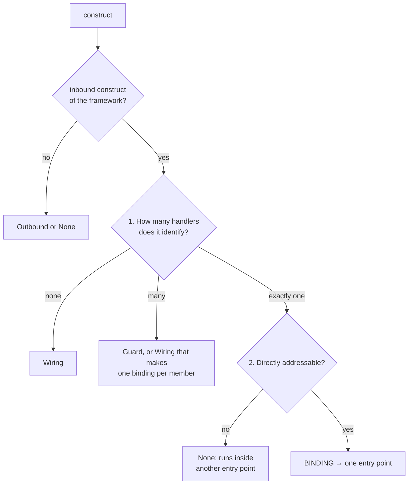

# Entry-Point Contract

This page defines what an **entry point** is and how a parser records one. The definition is
shared by every Breeze component — breezeai-cog, the Breeze plugin and the backend — so a "list
of entry points" means the same thing everywhere.

It is written for **parser authors**. Every rule can be decided from source code alone (and from
configuration files in the repository), without running the application. Sections 1–8 are the
contract and §9 gives worked role tables for four frameworks.

It expands the `semanticType` values in [the statement model](statement-model.md); the record
shape is `Statement` in `src/breezeai_cog/schemas/capture.py`.

**Contents**

1. [Definition](#1-definition)
2. [Construct roles](#2-construct-roles)
3. [The binding test](#3-the-binding-test)
4. [Common constructs and their roles](#4-common-constructs-and-their-roles)
5. [What a binding records](#5-what-a-binding-records)
6. [Address format](#6-address-format-endpoint)
7. [Examples](#7-examples)
8. [Accuracy rules](#8-accuracy-rules)
9. [Per-framework role tables](#9-per-framework-role-tables)

---

## 1. Definition

> An **entry point** is a place where control enters the application from outside its own code.
> Something outside the code starts it: an HTTP or RPC request, a GraphQL operation, a message or
> event, a schedule, or a user navigating to a page. It is the first code written for that
> trigger, and the rest of the flow starts from there.

A parser cannot watch the application run. It sees **constructs** — a decorator, a call, an
object in an array, a type in a signature, an entry in a config file. So the contract does not
ask "what runs first?"; it gives every construct a **role**, and the role decides what is
recorded.

## 2. Construct roles

Every framework construct a parser recognises has **exactly one** role:

| Role | The construct… | The parser records | Examples |
|---|---|---|---|
| **Binding** | names **one** handler as the target of an inbound trigger | **one entry-point record** | `@GetMapping("/x")` on a method · `r.get('/x', h)` · `{ path, component }` · `@KafkaListener` · `@Scheduled` |
| **Wiring** | adds part of an address (a prefix, a kind, a queue name) to **other** bindings, or marks a container whose members are bindings | **no entry-point record** — its value is copied into the bindings' records; a record is written only when what it carries is recorded nowhere else ([§5](#how-wiring-is-written-today)) | `app.use('/users', router)` · `loadChildren` · `@RequestMapping` on a class · `AddQueryType<T>()` · `serverless.yml` events |
| **Guard** | attaches code that runs before **many** handlers | the guard's name in `guards` on each affected record | `app.use(auth)` · `canActivate` · `[Authorize]` · a `<ProtectedRoute/>` layout element |
| **Outbound** | is our code calling something outside | an outbound record at the call (`api_call`, `eventbus_send`, a `route` link with `routeKind: navigation`, …) — not an entry point | `fetch(...)` · `sqs.sendMessage(...)` · `<Link to="/orders">` |
| **None** | is not inbound, or names one handler that has no address of its own | nothing | start-up calls, GraphQL data-type fields, everything else |

The **handler** is the declaration a binding points at: a method, a function or a component —
named, or anonymous (an inline function, [§5](#anonymous-handlers)).
The **address** is the name the outside world uses to reach it (§6).

## 3. The binding test

The test applies to the framework's **inbound constructs** — the ones its documentation uses to
receive a request, a message, a schedule or a page navigation. Which constructs those are is
decided **once per framework** by the parser author and written in its role table (§9), never
guessed per repository. Anything else is **outbound** (our code calling out) or **none**.

An inbound construct is a **binding** — and so produces an entry point — only if both checks
hold:



1. **Exactly one handler** — the construct identifies exactly one handler in source: the
   declaration it decorates, the function or component it references, or the member it
   registers.
   - It identifies **none** (it points at a router, a module or nothing) → **wiring**.
   - It applies to **many** handlers → a **guard**, or **wiring** that turns each member into a
     binding (a registered GraphQL root class makes each public method a binding).
2. **Directly addressable** — the construct gives the outside world an address that reaches the
   handler by itself: a URL, an operation name, a topic or queue, a schedule, a page path, or a
   type name the framework's own root field dispatches on (§4).
   - GraphQL **data-type fields** (`Book.author`) fail: a request must start at a root operation
     (`Query`, `Mutation`, `Subscription`), so `author` only runs inside an operation that
     returned a `Book`.

Layouts, partials, child components and modals never reach the test: no inbound construct
targets them.

> **Decision —** two checks, both about what the source shows: one handler, and an address.
> **Why:** an earlier check ("not reached only through another binding") asked how the code
> runs, which a parser cannot see, and in practice only ever excluded GraphQL data-type fields —
> which check 2 excludes by their missing address. The address check comes second because
> guards and wiring have no address of their own. A framework convention the checks cannot see
> (a GraphQL stub parent, §4) goes in that framework's role table.

## 4. Common constructs and their roles

| Construct | Role |
|---|---|
| HTTP route on a handler (decorator, route call, route-table entry with a component) | Binding |
| SOAP / WCF / gRPC operation | Binding |
| WebSocket endpoint: a connection handler (Ktor `webSocket`, FastAPI `@app.websocket`) or a message handler on a gateway (NestJS `@SubscribeMessage` in a `@WebSocketGateway` class) | Binding (`route`, `routeKind: ws`; `method: WEBSOCKET` for a connection, `MESSAGE` for one event) |
| GraphQL query / mutation / subscription field | Binding — in schema-first code, the resolver-map entry (`Query: { books: … }`) is the binding; the SDL root field (`type Query { books }`) is a plain statement with the DTOs; a Relay `node` / `nodes` field, which the framework serves, is a `route` ([§5](#how-wiring-is-written-today)) |
| Subscription that is also fed by a topic (HotChocolate `[Subscribe] [Topic("orders")]`) | Two bindings: the subscription (`route`) and the topic (`eventbus_consumer`) — one method, two triggers |
| GraphQL entity or node resolver (federation `__resolveReference`, Relay node lookup) | Binding (`route`, `method: RESOLVE_REFERENCE`, `routeKind: query`) — the framework's generated root field (`_entities`, `node`) calls it directly, addressed by type |
| GraphQL data-type field resolver (`Book.author`) | None — no address of its own (§3) |
| Message, queue, topic or event consumer — including message-pattern handlers on an RPC transport (NestJS `@MessagePattern` / `@EventPattern`) | Binding (`eventbus_consumer`) |
| Service registered on a message address (Vert.x `ServiceBinder…register(...)`) | Binding (`eventbus_consumer`), one per service method |
| Service proxy client (Vert.x `ServiceProxyBuilder…build(...)`) | Outbound (`eventbus_send`) |
| Service contract marker (Vert.x `@ProxyGen` interface) | None |
| Scheduled job: cron or interval annotation, recurring-job registration, timer call (`@Scheduled`, `@Cron`, `@Interval`, Hangfire `RecurringJob`, Quartz, Celery beat, Vert.x `setTimer` / `setPeriodic`) | Binding (`timer`) |
| Serverless function, classified by its trigger (a scheduled trigger such as AWS `ScheduledEvent` is a `timer`) | Binding. A handler whose trigger the code does not show (untyped `exports.handler`) stays a binding: `eventbus_consumer`, `framework: aws-lambda` (invoked by AWS, trigger unknown) until deployment config says more |
| Page reached by URL (SPA route, MVC action view, Razor Page, `.aspx`) — including a route whose component is loaded lazily (Angular `loadComponent`, React Router `lazy`) | Binding. A Web Forms page's handler is its code-behind class (GET and every postback share the page URL); a static `[WebMethod]` page method is its own binding at `<page>.aspx/<Method>` |
| Endpoint served by framework code with no handler of ours (`MapHealthChecks`, a GraphQL playground / dev UI) | Binding with an empty `handler` — a real URL outside callers reach |
| Class-level route prefix, router mount, lazy route group, layout route, root-type registration, deployment-config trigger | Wiring |
| Route with a `component` **and** `children` | Wiring (a layout) when one child has an empty path; otherwise **also** a Binding — its own URL shows the parent with an empty outlet |
| Middleware, filters, auth guards, interceptors | Guard |
| HTTP client call, message publish/send, DB query | Outbound |
| Link or programmatic navigation to a page (`<Link to>`, `routerLink`, `router.navigate`) | Outbound (`route`, `routeKind: navigation`) |
| Application start-up (`main`, `Program.cs`, `app.listen`) | None |
| Internal service / façade methods (only our own code calls them) | None |
| In-process actor messaging (Akka `receive`, local `!` / `tell`) | None — the message comes from our own code |
| Layouts, partials, child components, controls folded into a page | None (part of another entry point) |
| Modals, panels and tabs opened from a running page | None (part of another entry point) |
| GraphQL stub parent that only returns an object for its fields (`mutation { notifications { create } }`) | Wiring: its fields are the bindings, recorded as operations (`mutation`, not `field_resolver`). A convention, so it is listed in the framework's role table |
| Test fixtures, mocks, stories | None |

## 5. What a binding records

**One record per binding.** A handler reached by two bindings (two paths, two topics) gets two
records. **The record lives at the binding construct**: the decorated declaration, the route call,
the route-table entry, or — for a registered container — the member.

| Field | Content | Required |
|---|---|---|
| `semanticType` | `route` (request, RPC, GraphQL or page) · `eventbus_consumer` (message or event) · `timer` (schedule) · `mcp_tool` / `mcp_resource` / `mcp_prompt` (a tool, resource or prompt an MCP server exposes to AI clients) | Yes |
| `method` | HTTP verb · `ANY` (one handler for every verb) · `WEBSOCKET` · `QUERY` / `MUTATION` / `SUBSCRIPTION` / `RESOLVE_REFERENCE` · `RPC` · `MESSAGE` / `EVENT` / `CONSUMER` · `TIMER` / `PERIODIC` · `TOOL` (an `mcp_tool`, whose `endpoint` is the tool name) · `RESOURCE` (an `mcp_resource`, whose `endpoint` is the URI or URI template) · `PROMPT` (an `mcp_prompt`, whose `endpoint` is the prompt name) | When the trigger has one |
| `routeKind` | `route` (HTTP) · `rpc` (SOAP, WCF, gRPC) · `ws` (WebSocket) · `page` · `query` / `mutation` / `subscription` (also `message` on an `eventbus_consumer`) | Yes for `route` |
| `endpoint` | **The address** — the binding's own part joined with every wiring part ([§6](#6-address-format-endpoint)); a part read at runtime is marked `${name}` where it stands ([§6](#a-part-read-at-runtime-name)) | If a part can't be determined and isn't marked, or no literal path part is known: **empty**. Never guessed |
| `framework` | Transport or framework: `spring`, `express`, `graphql`, `aws-sqs`, `kafka`, `angular` … | Yes |
| `handler` | The handler's name: method, function or component | Yes, unless the handler is anonymous ([below](#anonymous-handlers)) |
| `handlerLine` | Line of the handler's declaration — the start line of its `Function` record, which for C# / Java includes attributes and annotations (for an anonymous handler, the line where the function starts); a line of `handlerPath` when that is set | Yes |
| `handlerPath` | Repo-relative file of the handler, when it is not the record's own file. A handler that can't be located, or is declared twice, leaves `handlerPath` and `handlerLine` empty — never a guessed file | When different |
| `guards` | Names of the guards that apply to it, outermost first — scoped ones (on the handler, its class, its route) and global ones (app-wide middleware, filters, router hooks) alike, when the code shows for certain that they cover this binding | When present |

### Anonymous handlers

A handler written inline has no name:

```ts
router.get('/', async (req, res) => { ... });       // line 12
```

It is still an entry point. Record it with:

| Field | Value |
|---|---|
| `handler` | **empty** — never an invented name (`anonymous`, `<lambda>`, `handler`) and never the route's variable or file name |
| `handlerLine` | the line where the function starts (`12`) |
| `handlerPath` | empty — an inline handler is in the record's own file, except on a property of an imported object (`Query: queries`, [GraphQL in TypeScript](../entry-point-roles/graphql-typescript.md)), where it is that object's file |

A function is **named** when the source gives it a name: a declaration (`function getUser`), a
method, or a function assigned to a variable or property (`const getUser = async () => …`). Only
a function with none of these is anonymous.

A Java **anonymous class** passed as the handler (`new Handler<Message>() { public void handle(…)
{ … } }`) is a `Class` of its own, and its method is a named `Function` (`Svc$1#handle`). Where
the framework's handler type has one method, that method is the handler: Vert.x gives `handler` =
`handle` and the `handlerLine` of that Function (no `handlerPath`: same file). A body with no such
method, or two overloads of it, keeps the inline line only.

**Wrappers are not handlers.** When the handler argument is a wrapper call around a function
(`asyncHandler(async (req, res) => { … })`), the handler is the **innermost function**. When a page
is wrapped in elements (`<Suspense><Dashboard/></Suspense>`), the handler is the **page
component** (`Dashboard`). A guard element used as a layout (`<ProtectedRoute/>`) is not a handler:
its name goes into `guards` on each child page.

### How wiring is written today

The roles above are the contract, and wiring has no record of its own: its value is copied into
the bindings' records and its code stays a plain statement. **A wiring record is written only
when what it carries is recorded nowhere else** — the address would otherwise be lost. Those
records, and links, use the Target Spec's current form (v36) until its entry-point proposal is
approved:

| Construct (role) | Written as | `routeKind` |
|---|---|---|
| Router mount whose routes aren't in the repo: an Express router from a package or ambiguous, an Angular lazy route group whose loaded routes have no records (a module outside the repo, an array of imported route objects), a Play `->` include of a SIRD class or a generated gRPC router (Wiring) | `route`, `ANY` (Express, Play), `endpoint` = the full prefix, `handler` = the router / module, empty for a bare import path | `mount` |
| Link or programmatic navigation (Outbound) | `route`, `endpoint` = the target page | `navigation` |
| GraphQL transport (`MapGraphQL`, Apollo `expressMiddleware`) | `route`, `POST`, `framework: graphql`, no handler (framework-served) | `route` |
| Framework middleware mounted at a path: Swagger UI, static files, `graphqlHTTP` / `createHandler`; Play `-> /webjars webjars.Routes` | `route`, `ANY` (`GET` for WebJars), no handler (framework-served) | `route` |
| `MapRoute` / `MapHttpRoute` convention template | `route`, `ANY` on the `MapRoute(…)` statement; `handler` = the default `Controller.Action`, empty when the template has `{controller}` or `{action}` | `route` |
| GraphQL SDL Relay field (`node` / `nodes` on `Query`) of a server's schema | `route`, `QUERY`, field name, DTOs, no handler (framework-served) | `query` |

A mount whose routes **are** in the repo has no record: an Express router this file defines or
`express.router-mounts` confirms, an Angular lazy route group whose loaded file has route records
under the resolved prefix, a Play include of a routes file of the repo. So do the parents and
layouts of route trees (Angular, Vue, React, React Router v7 `layout()`), a Web Forms user control
and the master page a page uses (both in `importFiles`), a `.svc` / `.asmx` host directive (its
operations carry the address) and an SDL root field (its resolver is the binding).

The validator (`parsers/contract.py`) does not count `mount` and `navigation` records as entry
points, and checks a `navigation` record's address like any outbound one. The other rows are
filed exactly like bindings.

Wiring that the spec does not record — a class-level prefix, a root-type registration, a
deployment-config trigger, `route(path)` before its verbs — has no record of its own: its code
stays in the statement the language extractor emits for it.

**Which records are outbound.** Each outbound kind is matched to the entry point it reaches:

| Entry point (inbound) | Its outbound counterpart | Matched on |
|---|---|---|
| `route` (HTTP, RPC, GraphQL) | `api_call` | `endpoint` (+ `method`) |
| `route` with `routeKind: page` | `route` with `routeKind: navigation` — a link or programmatic navigation, e.g. `<Link to="/orders">` | `endpoint` |
| `eventbus_consumer` | `eventbus_send` / `eventbus_publish` | `endpoint` |
| `timer` | — | — |

Records filed under `route` that are not entry points:

| `routeKind` | What it is | Why it is not an entry point |
|---|---|---|
| `field_resolver` (`method: RESOLVE_FIELD`) | A GraphQL data-type field resolver, e.g. `Book.author` | No address of its own (§3); recorded because it shows where a field's data comes from |
| `mount` | A router mount whose routes aren't in the repo, in the spec's current form (§5); `layout` is no longer written | Names no handler of its own |
| `navigation` | A link | Outbound |

The entry points are the `mcp_tool`, `mcp_resource` and `mcp_prompt` records, and the `route`,
`eventbus_consumer` and `timer` records whose `routeKind` is not `field_resolver`, `mount`,
`layout` or `navigation`.

> **Decision —** the entry-point record lives at the binding construct, never at the wiring.
> **Why:** the binding is the one construct that names exactly one handler, so one binding is
> one record and "all entry points" is an accurate count. Wiring contributes to many records (a
> prefix) or sits in another file (a registration, a config), so it can never own an entry
> point. **Cost:** wiring in another file must reach the binding's record through the repository
> index ([cross-file route composition](cross-file-resolution.md#8-cross-file-route-composition)).

### MCP tools

A tool an MCP server exposes is an entry point an AI client calls by name. Every tool is one
`mcp_tool` record at the construct that declares it:

| Field | Content |
|---|---|
| `method` | `TOOL` |
| `endpoint` | The name clients call, after any rename. A name that is not a literal → **no record** (the tool exists, but its name is unknown) |
| `framework` | The SDK the tool is declared with: `fastmcp`, `python-mcp`, `typescript-mcp`, `spring-ai-mcp`, `java-mcp`, `kotlin-mcp`, `csharp-mcp`, `mcp-go`, `go-mcp` |
| `handler` / `handlerLine` | The function that runs the tool; a lambda gives only its line ([above](#anonymous-handlers)) |
| `description` | The description the server gives the client, when it is a literal |
| `params` | The input parameters, in the shape of a function's `params`: `[{name, type, default, decorators, required, description}]` |
| `nodeType` | The construct's own node: `decorator` (Python), `attribute` (C#), `annotation` / `marker_annotation` (Spring AI), otherwise the call or object that declares it. Never `synthetic`: the construct is a real node. The same holds for `mcp_resource` and `mcp_prompt` |

- **Only on a proven MCP server.** A tool counts only when the code shows that the object it is
  declared on is an MCP server: a server object of the SDK, the SDK's own annotation or
  attribute, or a module whose build file declares an MCP server. Agent frameworks and chat
  clients use the same words (`@agent.tool`, Spring AI `@Tool`, `.tool(…)`); those are not
  entry points. Each framework's proof is in its role table.
- **Once.** A file can use two MCP frameworks; each tool is recorded once, by the package of
  the framework its construct belongs to.
- **One record per site in the code, not per server.** The record sits where the tool is
  written, so how many records a tool gets follows the construct each SDK reads:
  - Go SDK: one per `AddTool` call — a tool variable registered twice gives two records.
  - TypeScript low-level `Server`: one per tool object. A module-level `const` named in the
    `tools` arrays of two servers is one record, whose `handler` is the `CallToolRequestSchema`
    callback of the first server that lists it.
  - Kotlin SDK `addTools`: one per `RegisteredTool` element of the list, however many
    `addTools` calls receive it.
  - Java / Kotlin tool specifications: one per specification built, wherever it is passed
    (`.tools(spec…)` is not read); a builder shortcut `.tool(…)` is one per call.
  - Python low-level `Server`: one per `Tool(…)` literal in a `list_tools` function.
- **`params` is all or nothing.** `[]` means the tool takes no input (no schema, or an empty
  one). A schema that cannot be read whole (a variable, a spread, an unknown helper) leaves
  `params` unset, never a partial list. `required` is `true` / `false` when the schema says so
  and unset when it does not.
- **`params` stays within 15 KB** as JSON (the backend drops the whole field over 16 KB). Past
  it, parameter descriptions are kept in parameter order while they fit and the rest go
  without; names, types and defaults are always kept.
- **Incremental sync** (`/api/analyze-diff`): unchanged files are materialised empty, like for
  every cross-file fact. A changed tools file whose proof is in an unchanged file (a server
  imported from another module, a server starter in a build file) is re-ingested without its
  tools, and a sync that adds or removes such a proof leaves the unchanged tool files as they
  were. A full analysis restores them.

### MCP resources and prompts

A resource is data an AI client reads by URI; a prompt is a template it fetches by name. Both are
entry points held to the tool rules above (a proven server, a literal address, recorded once,
`params` all or nothing and within 15 KB), at the construct that declares them:

| Field | `mcp_resource` | `mcp_prompt` |
|---|---|---|
| `method` | `RESOURCE` | `PROMPT` |
| `endpoint` | The URI (`config://app`) or URI template (`users://{id}/profile`), as written | The prompt name |
| `name` | The resource's declared name when the SDK gives one as a literal (`"Profile"` beside its URI); otherwise (no name, or one that is not a literal) the URI | The prompt name (= `endpoint`) |
| `handler` / `handlerLine` | The function that reads it | The function that renders it |
| `description` | The description the server gives the client, when it is a literal | Same |
| `params` | A template's variables: each simple `{name}` → `{name, type: "string", required: true}`; `[]` for a fixed URI; unset when the template uses an RFC 6570 operator (`{?q}`, `{+path}`, `{#f}`, `{/s}`, `{.x}`, `{;x}`, `{&x}`), an explode (`{x*}`), a prefix (`{x:3}`) or several variables in one expression | Its arguments: `{name, required, description}`, never a `type` or `default` (an MCP prompt argument is a string), for every SDK; where the SDK builds them from a function's parameters (FastMCP, C#), those parameters' names, required (no default) and descriptions |

```python
@mcp.resource("users://{user_id}/profile", description="A user's profile")  # → mcp_resource, params [user_id]
def profile(user_id: str) -> str: ...

@mcp.prompt(name="review")                                                   # → mcp_prompt, params [code]
def review_code(code: str) -> str: ...
```

- A server API that lists them in one function (Python's low-level `@server.list_resources()` /
  `list_prompts()`, TypeScript's `ListResourcesRequestSchema` / `ListPromptsRequestSchema`
  handlers) gives one record per literal entry of the returned list; its handler is the server's
  single `read_resource` / `get_prompt` dispatcher in the same file (none, or several → unset).
- A fixed resource's URI is literal even with braces in it: `params` is `[]`.
- A resource's `name` is the name the code gives it — TypeScript `server.resource("Profile", uri,
  …)` / `registerResource("Profile", …)` and a low-level list entry's `name`, Python
  `types.Resource(name="Profile", …)` / `ResourceTemplate(name=…)` and FastMCP
  `@mcp.resource(uri, name="Profile")`, Spring AI `@McpResource(name = "Profile")`, the Java SDK's
  second `Resource` / `ResourceTemplate` constructor or builder argument (or `.name(…)`), the
  Kotlin SDK's `addResource(uri, name, …)`, C# `[McpServerResource(Name = "Profile")]`, mcp-go
  `NewResource(uri, "Profile")` and the Go SDK's `&mcp.Resource{Name: "Profile"}` — only when it
  is a literal; a name the SDK would derive (a FastMCP or C# method name) is not read, and the
  record keeps the URI as its `name`. A tool's and a prompt's `name` is their `endpoint`.
- A URI the SDK derives from a method (C# `[McpServerResource]` without `UriTemplate`) is not read:
  no record.

### MCP client calls

An `mcp_call` is outbound: a proven MCP **client** calls a tool, reads a resource or gets a
prompt, by a literal name or URI.

| Field | Content |
|---|---|
| `semanticType` | `mcp_call` |
| `method` | `TOOL` / `RESOURCE` / `PROMPT` |
| `endpoint` | The tool name, URI or prompt name, written like the server's `mcp_tool` / `mcp_resource` / `mcp_prompt` `endpoint` it reaches; a value that is not a literal → **no record** |
| `framework` | The client SDK: `python-mcp`, `fastmcp`, `typescript-mcp`, `mcp-go`, `go-mcp`, `java-mcp`, `kotlin-mcp`, `csharp-mcp` |
| `name` | Not set by the detector: the enriched call statement keeps the name it already has (an assignment target like `result`), an appended one has none — as for an `api_call` |
| `handler`, `description`, `params` | Never set |

```python
async with ClientSession(read, write) as session:
    await session.call_tool("search", {"q": "x"})   # → mcp_call  TOOL  search
```

- **Only on a proven client.** The receiver must be the SDK's client (constructed, typed, or
  returned by the SDK's factory). Agent frameworks that wrap MCP servers
  (`MCPServerStdio.call_tool`, LlamaIndex `BasicMCPClient`, LangChain `MultiServerMCPClient`), the
  AI SDK's `experimental_createMCPClient`, an `aiohttp` `ClientSession`, a `pg` `Client`, and a
  client taken from a list (`clients.get(0).callTool(…)`) are not.
- **The call's own statement.** The record enriches the innermost captured statement that
  contains the call when it is unclassified and starts on the call's line (keeping its `name`),
  so that line keeps one statement. It is the statement the call is in, not just any statement
  on its line: `x = 1; await s.call_tool("t")` enriches the call's statement, `async with
  ClientSession(r, w) as s: await s.call_tool("x")` and `} catch (e) { await
  client.callTool(…) }` enrich the body's statement and leave the `with` / `catch` unclassified.
  A call inside a statement that starts on an earlier line — an argument of a multi-line
  `gather(…)` / `Promise.all([…])`, the second line of an `if` condition — or in a control-flow
  header (`if (await s.call_tool("x")).isError:`) gets a record of its own on its line instead.
- **No file framework.** A file with only client calls keeps `framework` unset: it is not an MCP
  server.
- **A spread after the literal** (`client.callTool({ name: "x", ...req })`) may override it at
  runtime: no record. A spread before it is overridden by it and changes nothing.
- **Java, Kotlin and C# clients are proven by name within their class.** A name declared in a
  class as a client (typed, or assigned the SDK's factory), and as nothing else in that class,
  is a client wherever that name is called in the same class (the innermost `class`, `object`,
  `struct`, `record` or `interface` around the call; the file's top level outside them). A
  same-named `client` in another class — inherited from a base class, or declared in an outer
  class — is not taken for it (no record). Within the class, a Kotlin `with` / scope-function
  receiver with a member of the same name can still be taken for it. Python and TypeScript
  resolve the call's nearest binding instead.
- **Client detectors also run on fixture and test files**, unlike the server detectors (an
  `mcp_call` is outbound, not an entry point): a test that calls a tool through a real client
  records that call.
- The contract checks an `mcp_call` like other outbound records (no empty or placeholder
  `endpoint`), and also that it has a `method` of `TOOL` / `RESOURCE` / `PROMPT`, a `framework`, an
  `endpoint` and no handler.

## 6. Address format (`endpoint`)

The same format is used on both sides: an outbound record's `endpoint` (`api_call`,
a `route` link, `eventbus_send`, `mcp_call`) is written exactly like the entry point it reaches,
so the two match.

| Trigger | `endpoint` contains | Example |
|---|---|---|
| HTTP | Full path with every prefix applied (verb goes in `method`) | `/api/v2/orders/{id}` |
| SOAP | `<Service>.asmx/<Operation>` or `<Contract>/<Operation>` | `Orders.asmx/GetOrder` |
| gRPC | `<Service>/<Method>`, the service by its full name — with the proto package when the `.proto` declares one, as gRPC itself names the method (`/orders.OrderService/GetOrder` on the wire, without the leading `/`) | `orders.OrderService/GetOrder`, `OrderService/GetOrder` (no package) |
| GraphQL | Operation field name (type goes in `method`); for a field under a stub parent, `<StubType>.<field>` | `bookById`, `NotificationsMutation.create` |
| GraphQL entity / node resolver | The type it resolves | `Book` |
| WebSocket message | The event name; `<namespace>#<event>` when the gateway sets a socket.io namespace, written as a client writes it in `io('http://host/chat')`. Not a URL: the connection URL and port are shared by every handler, and `#` keeps the address from reading as a path | `msg`, `/chat#msg` |
| Message / event | Queue, topic or address name; an object pattern as canonical JSON with sorted keys (the form the transport matches on) | `billing`, `orders.created`, `{"cmd":"sum"}` |
| Schedule | Cron or interval expression | `0 2 * * *` |
| Page | URL path, with parent prefixes applied | `/settings/profile` |

### A part read at runtime (`${name}`)

Many apps build an address from a value cog cannot read — a context root, base path, prefix or
whole URL from a config file, an env var, a settings object, a variable or a call — plus a literal
path. cog never guesses the value; it keeps the address with the value **marked where it stands**,
named after where it comes from:

- **`${…}`** — a value cog cannot read: it may be empty, one path segment, several, a scheme and
  host, or a whole address. Fixed for a deployment, never filled by a caller.
- **`{name}`, `:name`, `<name>`** — a path parameter or request value: one segment, filled per
  request. A framework's own parameter syntax is kept as written.

What is inside a marker names the value's **source**, the same way for both markers, so two values
never share a name only because their last parts match:

| The value in the code | Its name |
|---|---|
| A configuration entry read by literal keys: `config().getJsonObject("api-verticle").getString("address")`, `config.get("base")`, `env.getProperty("app.base")` | `config:` and the key path: `${config:api-verticle.address}`, `${config:base}`, `${config:app.base}` |
| An environment variable: `process.env.BASE_PATH`, `os.getenv("BASE")`, `System.getenv("BUS")` | `env:` and its name: `${env:BASE_PATH}`, `${env:BASE}`, `${env:BUS}` |
| A name or member path (a variable, a field, a constant cog cannot resolve) | written whole, less a leading `this.` / `self.`: `config.contextRoot` → `${config.contextRoot}`, `user.id` → `{user.id}`, `this.userId` → `{userId}` |
| A local variable assigned once from a configuration or environment lookup | named after that lookup (`String address = config().getString("a"); send(address, …)` → `${config:a}`; `const p = process.env.P; app.get(p, h)` → `${env:P}`). Assigned twice, reassigned, or shadowed by a parameter of that name: named as itself (`${address}`) |
| Another lookup by a literal key | the key: `map.get("pathPrefix")` → `${pathPrefix}` |
| Another call | `${…}`: the called function (`prefixFromEnv()` → `${prefixFromEnv}`); `{param}` for a request value (`encodeURIComponent(id)`) |
| Values added with no string between them | one marker each: `prefix + host + ":" + port` → `${prefix}${host}:${port}`; a parenthesised sum `(page + 1)` stays one value |
| Anything else | `${value}` / `{param}` |

Which marker a part becomes:

- in an **inbound** route path or an **event-bus address**, every part cog cannot read is `${…}`
  (a request value enters a route only through the framework's own parameter syntax);
- in an **outbound** URL, a part in the base — before the path's first `/`, the scheme and host
  included — is `${…}`; a later part is a request value, `{name}` — except a configuration entry
  or environment variable, which is `${…}` wherever it stands.

An address made **only of named markers is kept**: it names where the address comes from, not the
address (`${url}`, `${config:api-verticle.address}`, `${fileApiPrefix}${fileApiHost}:${filePort}${fileApiPath}`).
An address is empty only when no part has a name (`${value}`, `{param}` only): that says nothing.
The URL of a call is taken from a variable only when the call takes its URL first — an HTTP verb
(`get`, `post`, …), `fetch`, a `url(…)` / `uri(…)` builder, a RestTemplate verb — and never from a
verb on a request builder (`ws.url(u).post(body)`: `post` takes the body); an event-bus address
only on the bus itself (`vertx.eventBus().send(addr, …)`, not a wrapper such as
`EventBusUtil.send(container, …)`).

| Code | Kind | `endpoint` |
|---|---|---|
| `router.get(config().getString("pathPrefix") + "/request")` (Vert.x), ``app.get(`${BASE}/users/:id`)`` (Express) | route | `${config:pathPrefix}/request`, `${BASE}/users/:id` |
| `router.get("/api/" + version + "/orders")` | route | `/api/${version}/orders` |
| `register(p, { prefix: config.base })` (Fastify), `setGlobalPrefix(config.x)` (NestJS), `include_router(r, prefix=settings.X)` (FastAPI), `route(prefixFromEnv()) { … }` (Ktor), `basePath: process.env.BASE_PATH` (LoopBack, Next.js), a Vert.x sub-router mounted once at such a prefix | route | `${config.base}/…`, `${config.x}/…`, `${settings.X}/…`, `${prefixFromEnv}/…`, `${env:BASE_PATH}/…` |
| ``app.get(`${BASE}`, h)`` | route | `${BASE}` |
| `router.get(path).handler(h)`, `app.get(ordersPath, h)`, `app.get(routes.orders, h)` (a whole path that is one value: [how it is told from another argument](#a-path-that-is-one-value)) | route | `${path}`, `${ordersPath}`, `${routes.orders}`; `${config:orders.path}` / `${env:ORDERS_PATH}` when the variable is read once from there |
| `axios.post(config.contextRoot + "/orders/confirm")`, `` fetch(`${base}/orders/${id}`) ``, `$.ajax({ url: ctx + "/x/" + order.id })` — and the same shapes in every language's HTTP calls | outbound | `${config.contextRoot}/orders/confirm`, `${base}/orders/{id}`, `${ctx}/x/{order.id}` |
| `$.get("/api/users/" + user.id + "/roles")`, `` $.getJSON(`/api/users/${id}`) `` — a jQuery URL reads exactly as the same `axios` URL | outbound | `/api/users/{user.id}/roles`, `/api/users/{id}` |
| `axios.get(url)`, `$.ajax({ url: form.action })`, `new HttpGet(uri)`, `` fetch(`${host}${path}`) `` | outbound | `${url}`, `${form.action}`, `${uri}`, `${host}${path}` |
| `new HttpPost(fileApiPrefix + fileApiHost + ":" + filePort + fileApiPath)` | outbound | `${fileApiPrefix}${fileApiHost}:${filePort}${fileApiPath}` |
| `send(config().getObject("api-verticle").getString("address"), …)`, `consumer(config().getString("address"), h)`, `send(System.getenv("BUS") + ".orders", …)` | event bus | `${config:api-verticle.address}`, `${config:address}`, `${env:BUS}.orders` |
| `axios.get(buildUrl(a, b) \|\| fallback)` | outbound | empty: no part has a name |

**Reading it.** An endpoint made only of `${…}` parts names the **source** of the address: two
records with the same `${…}` read the same variable or key, but each module or deployment may set
it differently, so records are **never joined on equal `${…}` text**. A reader comparing a call
with a route drops the leading `${…}`, compares the rest (treating `{id}`, `:id` and `<id>` alike),
and gets a **candidate**, never a certain match; it never matches through a `${…}` part. The
unknown part is never written `{name}`: that would read as one segment a caller fills in. The
marker is cog's, never copied source syntax (a JavaScript template literal's `${x}` is read and
re-marked). Unchanged: a prefix cog resolves (Spring context path, Next.js `basePath`, JAX-RS
application path, a literal or constant), a real path parameter (`/api/orders/{id}`), and a router
mounted at two known prefixes (empty). Every outbound URL and every route address goes
through `parsers/addresses.py` once per file, so the notation is the same in every language.

### A path that is one value

Naming a value says what an address is built from; it does not say whether an argument **is**
an address. A detector decides that first, from the code around the argument, and the
evidence it asks for grows as the argument says less:

| The first argument | What makes it a path | Example: recorded | Example: not recorded |
|---|---|---|---|
| Has a literal part (a string, a template with text, a sum with a string) | the receiver and verb, as for any literal path | `router.get(prefix + "/x")` → `${prefix}/x` | — |
| Is one value: a name, a member path, or a configuration / environment read | **all of**: (1) a receiver the file certainly holds as an app or router — bound to `Router.router(vertx)`, `new RouteMatcher()`, `express()`, `Router()` / `express.Router()`, or a field or parameter typed as one, never a receiver known only by its name; (2) a handler — the verb's second argument or a chained `.handler(…)`; (3) the value is no function or router of the file | `router.get(path).handler(this::list)` → `${path}`; `app.get(ordersPath, listOrders)` → `${ordersPath}` | `router.get(path)` (no handler); `cache.get(key, onHit)` (no router); `app.get(listOrders, x)` (a function); `router.get(helper()).handler(h)` (another call) |
| Is one value, on a mount (`app.use(value, router)`) | (1) and (2) above, the mounted argument a router of this file, **and** the value a configuration or environment read (directly or through a variable read once from it): the first argument of `use` is as often a middleware | `app.use(process.env.API, apiRouter)` → the router's routes under `${env:API}` | `app.use(logger, apiRouter)`; `app.use(authMiddleware)` |
| Anything else (a call that is no configuration read, an object, a function) | never a path | — | `app.use(helmet(), cors())` |

The record is then named as any other value is (the table above): `${path}`, or
`${config:orders.path}` / `${env:ORDERS_PATH}` when the variable is assigned once from that read.
A router mounted at a base read at runtime carries the marked base into its routes, first
(`${env:API}/orders`, `${BASE}/api/orders`), as a Vert.x sub-router does; mounted at two bases, or
at a value that is neither, its routes stay empty. Applied to Vert.x (Java) and Express routes; a
variable read once from configuration names a **whole** path or event-bus address — inside a
built path (`pathPrefix + "/x"`) each part is still named as written (`${pathPrefix}/x`).

## 7. Examples

```java
@RequestMapping("/api")                            // WIRING: prefix for the class's bindings
class OrderController {
  @GetMapping("/orders/{id}")                      // BINDING → route, GET, /api/orders/{id}, handler get
  public Order get(String id) { ... }
}
```

```ts
app.use(authenticate);                             // GUARD → guards: [authenticate] on every route
app.use('/users', usersRouter());                  // WIRING: prefix /users for usersRouter's bindings;
                                                   //   written as route / mount today (§5)
r.get('/:id', getUser);                            // BINDING → route, GET, /users/:id, handler getUser
r.post('/', async (req, res) => { ... });          // BINDING → route, POST, /users, handler empty,
                                                   //   handlerLine = this line (anonymous)
```

```csharp
.AddQueryType<BookQueries>();                      // WIRING (Program.cs): BookQueries is the query root
public Book GetBookById(int id) { ... }            // BINDING (BookQueries.cs) → route, QUERY, bookById
```

```csharp
public Task FunctionHandler(SQSEvent e, ILambdaContext c)
                                                   // BINDING → eventbus_consumer, aws-sqs,
                                                   //   endpoint: queue from config (WIRING), else empty
```

```ts
{ path: 'settings', component: SettingsPage }      // BINDING → route, page, /settings, handler SettingsPage
{ path: 'admin', loadChildren: () => import(...) } // WIRING: prefix /admin for the loaded module's routes
```

## 8. Accuracy rules

- **Wrong is worse than missing.** If the address can't be resolved, record the entry point with
  an empty `endpoint` — never a guess. A part read at runtime (`include_router(r,
  prefix=settings.X)`, `setGlobalPrefix(config.x)`) is not guessed either: it is marked
  `${name}` where it stands ([§6](#a-part-read-at-runtime-name)), never dropped (a partial path
  would read as the whole address) and never written `{name}` (a path parameter). A message address that can't be resolved
  is empty on both sides — consumer and sender — rather than the symbol it was read from.
- **When unsure of a role, choose the one that records less.** A construct that might be a
  router or a middleware is wiring, not a guard; a construct that might not be inbound is None.
- **One binding, one record.** Wiring and guards never produce entry-point records (wiring the
  Target Spec records today is written in its form, §5).
- **Every record leads to its handler** (`handler` + `handlerLine` + `handlerPath`; for an
  anonymous handler, `handlerLine` alone) — that is where the rest of the flow starts.

---

## 9. Per-framework role tables

Every parser that records entry points keeps a role table like these in
[`docs/entry-point-roles/`](../entry-point-roles/README.md). Its tests
(`tests/unit/test_roles_<framework>.py`) cover each row, and a reviewer checks the parser against
its own table. The tables below are examples of what the contract requires; the full tables live
there.

### Express

| Construct | Role | Why |
|---|---|---|
| `app.METHOD(path, …, handler)` / `router.METHOD(...)` / `router.route(path).METHOD(handler)` | Binding | One handler, inbound API |
| Extra functions before the handler in that call | Guard | Run before this handler (and are named middleware) |
| `app.use(path, router)` | Wiring | Points at a router (no handler): prefix only |
| `app.use(fn)` / `app.use(path, fn)` where `fn` is middleware | Guard | Runs before many handlers |
| `app.use(path, x)` where it is unclear whether `x` is a router or middleware | Wiring | §8: choose the role that records less |
| `app.listen(port)` | None | Start-up |

### Spring

| Construct | Role | Why |
|---|---|---|
| `@GetMapping` / `@PostMapping` / … / `@RequestMapping` on a method | Binding | One handler, inbound API |
| `@RequestMapping` on a controller class | Wiring | Prefix for the class's bindings |
| `server.servlet.context-path` in `application.properties` / `.yml` | Wiring | Prefix for every HTTP binding served by the servlet — not WebFlux.fn routes, which take `spring.webflux.base-path` |
| `@KafkaListener` / `@RabbitListener` / `@JmsListener` / `@SqsListener` on a method | Binding | `eventbus_consumer`, topic or queue as `endpoint` |
| `@Scheduled(cron = …)` on a method | Binding | `timer`, cron expression as `endpoint` |
| `@PreAuthorize`, `HandlerInterceptor`, servlet `Filter` | Guard | Run before many handlers |
| `RestTemplate` / `WebClient` calls | Outbound | |
| `SpringApplication.run(...)` | None | Start-up |

### HotChocolate (C# GraphQL)

| Construct | Role | Why |
|---|---|---|
| `[QueryType]` / `[MutationType]` / `[SubscriptionType]` on a class | Wiring | Marks a root container: each public method or property becomes a binding |
| `[ExtendObjectType(OperationTypeNames.Query)]` (or `"Query"`, `typeof(Query)`) on a class | Wiring | Same, for an extension of a root |
| `AddQueryType<T>()` / `AddMutationType<T>()` / `AddSubscriptionType<T>()` | Wiring | Registers `T` as a root container, usually from another file |
| Public method or property of a root container | Binding | One operation: `QUERY` / `MUTATION` / `SUBSCRIPTION`, field name as `endpoint` |
| `descriptor.Field(...)` in `Configure` of a root `ObjectType<T>` / `ObjectTypeExtension` | Binding | One operation, declared fluently |
| Fields of a data type (`[ExtendObjectType(typeof(Book))]`, `[Parent]` resolvers, `ObjectType<Book>` fields whose resolver reads its object: `ctx.Parent<Book>()`, or a `[Parent]` `ResolveWith` method) | None | No address of their own; recorded as `routeKind: field_resolver`, not counted (§5). Other `ObjectType<Book>` fields stay plain statements |
| `[ReferenceResolver]` on a type (Apollo Federation) | Binding | Called by the gateway through the generated `_entities` field: `method: RESOLVE_REFERENCE`, `routeKind: query`, type name as `endpoint` |
| `[NodeResolver]` on a type marked `[Node]` (Relay, `AddGlobalObjectIdentification`) | Binding | Called through the generated `node` field: `method: RESOLVE_REFERENCE`, `routeKind: query`, type name as `endpoint` |
| `[Authorize]` / `.Authorize(...)` | Guard | |
| `MapGraphQL("/graphql")` | Wiring | Transport path; GraphQL bindings are addressed by operation name |
| `AddGraphQLServer()` | None | Start-up |

### Angular

| Construct | Role | Why |
|---|---|---|
| `{ path, component }` in a `Routes` array / `RouterModule.forRoot` / `forChild` | Binding | One component reached by URL |
| `{ path, loadComponent }` | Binding | One component, loaded lazily |
| `{ path, loadChildren }` | Wiring | Points at a module or route list: prefix for its routes |
| `{ path, children: [...] }` | Wiring | Prefix for the children |
| `{ path, component, children: [...] }` | Wiring when a child has `path: ''`; otherwise also a Binding | A layout when a child always fills its outlet; otherwise its own URL shows it with an empty outlet |
| `{ path, redirectTo }` | Outbound | `route`, `routeKind: navigation`: sends the user to the target page |
| `canActivate` / `canMatch` / `canActivateChild` | Guard | |
| `HttpClient` calls | Outbound | |
| `routerLink` / `router.navigate(...)` | Outbound | `route`, `routeKind: navigation` |
| `bootstrapApplication(...)` / `platformBrowserDynamic().bootstrapModule(...)` | None | Start-up |
