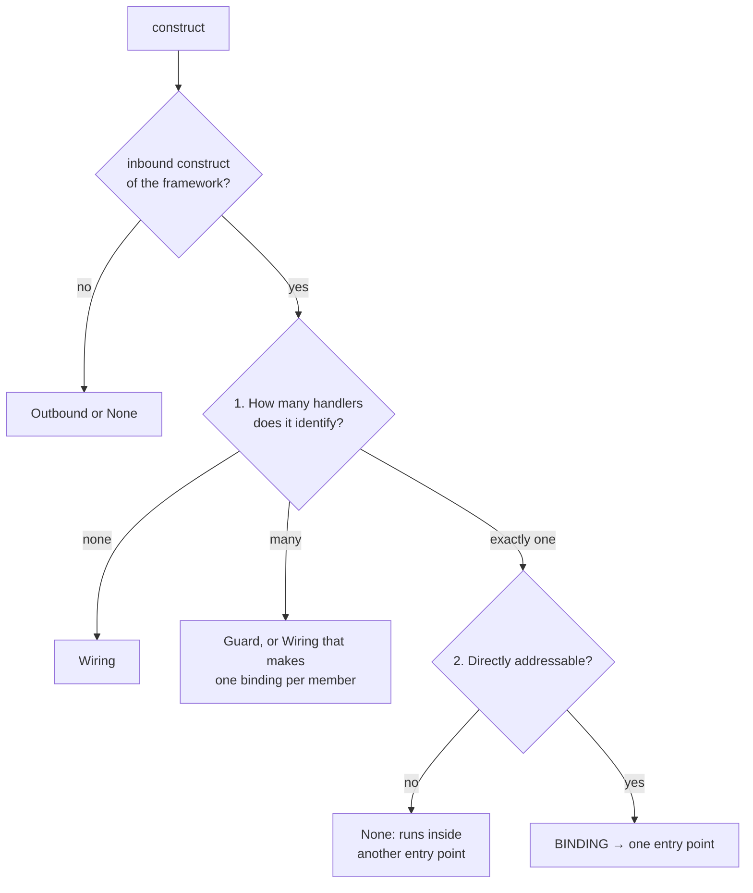

# Entry-Point Contract

This page defines what an **entry point** is and how a parser records one. The definition is
shared by every Breeze component — breezeai-cog, the Breeze plugin and the backend — so a "list
of entry points" means the same thing everywhere.

It is written for **parser authors**. Every rule can be decided from source code alone (and from
configuration files in the repository), without running the application. Sections 1–8 are the
contract and §9 gives worked role tables for four frameworks.

It expands the `semanticType` values in [the statement model](statement-model.md); the record
shape is `Statement` in `src/breezeai_cog/schemas/capture.py`.

**Contents**

1. [Definition](#1-definition)
2. [Construct roles](#2-construct-roles)
3. [The binding test](#3-the-binding-test)
4. [Common constructs and their roles](#4-common-constructs-and-their-roles)
5. [What a binding records](#5-what-a-binding-records)
6. [Address format](#6-address-format-endpoint)
7. [Examples](#7-examples)
8. [Accuracy rules](#8-accuracy-rules)
9. [Per-framework role tables](#9-per-framework-role-tables)

---

## 1. Definition

> An **entry point** is a place where control enters the application from outside its own code.
> Something outside the code starts it: an HTTP or RPC request, a GraphQL operation, a message or
> event, a schedule, or a user navigating to a page. It is the first code written for that
> trigger, and the rest of the flow starts from there.

A parser cannot watch the application run. It sees **constructs** — a decorator, a call, an
object in an array, a type in a signature, an entry in a config file. So the contract does not
ask "what runs first?"; it gives every construct a **role**, and the role decides what is
recorded.

## 2. Construct roles

Every framework construct a parser recognises has **exactly one** role:

| Role | The construct… | The parser records | Examples |
|---|---|---|---|
| **Binding** | names **one** handler as the target of an inbound trigger | **one entry-point record** | `@GetMapping("/x")` on a method · `r.get('/x', h)` · `{ path, component }` · `@KafkaListener` · `@Scheduled` |
| **Wiring** | adds part of an address (a prefix, a kind, a queue name) to **other** bindings, or marks a container whose members are bindings | **no entry-point record** — its value is copied into the bindings' records; a record is written only when what it carries is recorded nowhere else ([§5](#how-wiring-is-written-today)) | `app.use('/users', router)` · `loadChildren` · `@RequestMapping` on a class · `AddQueryType<T>()` · `serverless.yml` events |
| **Guard** | attaches code that runs before **many** handlers | the guard's name in `guards` on each affected record | `app.use(auth)` · `canActivate` · `[Authorize]` · a `<ProtectedRoute/>` layout element |
| **Outbound** | is our code calling something outside | an outbound record at the call (`api_call`, `eventbus_send`, a `route` link with `routeKind: navigation`, …) — not an entry point | `fetch(...)` · `sqs.sendMessage(...)` · `<Link to="/orders">` |
| **None** | is not inbound, or names one handler that has no address of its own | nothing | start-up calls, GraphQL data-type fields, everything else |

The **handler** is the declaration a binding points at: a method, a function or a component —
named, or anonymous (an inline function, [§5](#anonymous-handlers)).
The **address** is the name the outside world uses to reach it (§6).

## 3. The binding test

The test applies to the framework's **inbound constructs** — the ones its documentation uses to
receive a request, a message, a schedule or a page navigation. Which constructs those are is
decided **once per framework** by the parser author and written in its role table (§9), never
guessed per repository. Anything else is **outbound** (our code calling out) or **none**.

An inbound construct is a **binding** — and so produces an entry point — only if both checks
hold:



1. **Exactly one handler** — the construct identifies exactly one handler in source: the
   declaration it decorates, the function or component it references, or the member it
   registers.
   - It identifies **none** (it points at a router, a module or nothing) → **wiring**.
   - It applies to **many** handlers → a **guard**, or **wiring** that turns each member into a
     binding (a registered GraphQL root class makes each public method a binding).
2. **Directly addressable** — the construct gives the outside world an address that reaches the
   handler by itself: a URL, an operation name, a topic or queue, a schedule, a page path, or a
   type name the framework's own root field dispatches on (§4).
   - GraphQL **data-type fields** (`Book.author`) fail: a request must start at a root operation
     (`Query`, `Mutation`, `Subscription`), so `author` only runs inside an operation that
     returned a `Book`.

Layouts, partials, child components and modals never reach the test: no inbound construct
targets them.

> **Decision —** two checks, both about what the source shows: one handler, and an address.
> **Why:** an earlier check ("not reached only through another binding") asked how the code
> runs, which a parser cannot see, and in practice only ever excluded GraphQL data-type fields —
> which check 2 excludes by their missing address. The address check comes second because
> guards and wiring have no address of their own. A framework convention the checks cannot see
> (a GraphQL stub parent, §4) goes in that framework's role table.

## 4. Common constructs and their roles

| Construct | Role |
|---|---|
| HTTP route on a handler (decorator, route call, route-table entry with a component) | Binding |
| SOAP / WCF / gRPC operation | Binding |
| GraphQL query / mutation / subscription field | Binding — in schema-first code, the resolver-map entry (`Query: { books: … }`) is the binding; the SDL root field (`type Query { books }`) is a plain statement with the DTOs; a Relay `node` / `nodes` field, which the framework serves, is a `route` ([§5](#how-wiring-is-written-today)) |
| Subscription that is also fed by a topic (HotChocolate `[Subscribe] [Topic("orders")]`) | Two bindings: the subscription (`route`) and the topic (`eventbus_consumer`) — one method, two triggers |
| GraphQL entity or node resolver (federation `__resolveReference`, Relay node lookup) | Binding (`route`, `method: RESOLVE_REFERENCE`, `routeKind: query`) — the framework's generated root field (`_entities`, `node`) calls it directly, addressed by type |
| GraphQL data-type field resolver (`Book.author`) | None — no address of its own (§3) |
| Message, queue, topic or event consumer — including message-pattern handlers on an RPC transport (NestJS `@MessagePattern` / `@EventPattern`) | Binding (`eventbus_consumer`) |
| Service registered on a message address (Vert.x `ServiceBinder…register(...)`) | Binding (`eventbus_consumer`), one per service method |
| Service proxy client (Vert.x `ServiceProxyBuilder…build(...)`) | Outbound (`eventbus_send`) |
| Service contract marker (Vert.x `@ProxyGen` interface) | None |
| Scheduled job: cron or interval annotation, recurring-job registration, timer call (`@Scheduled`, `@Cron`, `@Interval`, Hangfire `RecurringJob`, Quartz, Celery beat, Vert.x `setTimer` / `setPeriodic`) | Binding (`timer`) |
| Serverless function, classified by its trigger (a scheduled trigger such as AWS `ScheduledEvent` is a `timer`) | Binding. A handler whose trigger the code does not show (untyped `exports.handler`) stays a binding: `eventbus_consumer`, `framework: aws-lambda` (invoked by AWS, trigger unknown) until deployment config says more |
| Page reached by URL (SPA route, MVC action view, Razor Page, `.aspx`) — including a route whose component is loaded lazily (Angular `loadComponent`, React Router `lazy`) | Binding. A Web Forms page's handler is its code-behind class (GET and every postback share the page URL); a static `[WebMethod]` page method is its own binding at `<page>.aspx/<Method>` |
| Endpoint served by framework code with no handler of ours (`MapHealthChecks`, a GraphQL playground / dev UI) | Binding with an empty `handler` — a real URL outside callers reach |
| Class-level route prefix, router mount, lazy route group, layout route, root-type registration, deployment-config trigger | Wiring |
| Route with a `component` **and** `children` | Wiring (a layout) when one child has an empty path; otherwise **also** a Binding — its own URL shows the parent with an empty outlet |
| Middleware, filters, auth guards, interceptors | Guard |
| HTTP client call, message publish/send, DB query | Outbound |
| Link or programmatic navigation to a page (`<Link to>`, `routerLink`, `router.navigate`) | Outbound (`route`, `routeKind: navigation`) |
| Application start-up (`main`, `Program.cs`, `app.listen`) | None |
| Internal service / façade methods (only our own code calls them) | None |
| In-process actor messaging (Akka `receive`, local `!` / `tell`) | None — the message comes from our own code |
| Layouts, partials, child components, controls folded into a page | None (part of another entry point) |
| Modals, panels and tabs opened from a running page | None (part of another entry point) |
| GraphQL stub parent that only returns an object for its fields (`mutation { notifications { create } }`) | Wiring: its fields are the bindings, recorded as operations (`mutation`, not `field_resolver`). A convention, so it is listed in the framework's role table |
| Test fixtures, mocks, stories | None |

## 5. What a binding records

**One record per binding.** A handler reached by two bindings (two paths, two topics) gets two
records. **The record lives at the binding construct**: the decorated declaration, the route call,
the route-table entry, or — for a registered container — the member.

| Field | Content | Required |
|---|---|---|
| `semanticType` | `route` (request, RPC, GraphQL or page) · `eventbus_consumer` (message or event) · `timer` (schedule) | Yes |
| `method` | HTTP verb · `ANY` (one handler for every verb) · `WEBSOCKET` · `QUERY` / `MUTATION` / `SUBSCRIPTION` / `RESOLVE_REFERENCE` · `RPC` · `MESSAGE` / `EVENT` / `CONSUMER` · `TIMER` / `PERIODIC` | When the trigger has one |
| `routeKind` | `route` (HTTP) · `rpc` (SOAP, WCF, gRPC) · `ws` (WebSocket) · `page` · `query` / `mutation` / `subscription` (also `message` on an `eventbus_consumer`) | Yes for `route` |
| `endpoint` | **The address, fully resolved** — the binding's own part joined with every wiring part ([§6](#6-address-format-endpoint)) | If any part can't be determined: **empty**. Never guessed, never a code name |
| `framework` | Transport or framework: `spring`, `express`, `graphql`, `aws-sqs`, `kafka`, `angular` … | Yes |
| `handler` | The handler's name: method, function or component | Yes, unless the handler is anonymous ([below](#anonymous-handlers)) |
| `handlerLine` | Line of the handler's declaration — the start line of its `Function` record, which for C# / Java includes attributes and annotations (for an anonymous handler, the line where the function starts) | Yes |
| `handlerPath` | File of the handler, when it is not the record's own file | When different |
| `guards` | Names of the guards that apply to it, outermost first — scoped ones (on the handler, its class, its route) and global ones (app-wide middleware, filters, router hooks) alike, when the code shows for certain that they cover this binding | When present |

### Anonymous handlers

A handler written inline has no name:

```ts
router.get('/', async (req, res) => { ... });       // line 12
```

It is still an entry point. Record it with:

| Field | Value |
|---|---|
| `handler` | **empty** — never an invented name (`anonymous`, `<lambda>`, `handler`) and never the route's variable or file name |
| `handlerLine` | the line where the function starts (`12`) |
| `handlerPath` | empty — an inline handler is always in the record's own file |

A function is **named** when the source gives it a name: a declaration (`function getUser`), a
method, or a function assigned to a variable or property (`const getUser = async () => …`). Only
a function with none of these is anonymous.

**Wrappers are not handlers.** When the handler argument is a wrapper call around a function
(`asyncHandler(async (req, res) => { … })`), the handler is the **innermost function**. When a page
is wrapped in elements (`<Suspense><Dashboard/></Suspense>`), the handler is the **page
component** (`Dashboard`). A guard element used as a layout (`<ProtectedRoute/>`) is not a handler:
its name goes into `guards` on each child page.

### How wiring is written today

The roles above are the contract, and wiring has no record of its own: its value is copied into
the bindings' records and its code stays a plain statement. **A wiring record is written only
when what it carries is recorded nowhere else** — the address would otherwise be lost. Those
records, and links, use the Target Spec's current form (v36) until its entry-point proposal is
approved:

| Construct (role) | Written as | `routeKind` |
|---|---|---|
| Router mount whose routes aren't in the repo: an Express router from a package or ambiguous, an Angular lazy route group whose loaded routes have no records (a module outside the repo, an array of imported route objects), a Play `->` include of a SIRD class or a generated gRPC router (Wiring) | `route`, `ANY` (Express, Play), `endpoint` = the full prefix, `handler` = the router / module, empty for a bare import path | `mount` |
| Link or programmatic navigation (Outbound) | `route`, `endpoint` = the target page | `navigation` |
| GraphQL transport (`MapGraphQL`, Apollo `expressMiddleware`) | `route`, `POST`, `framework: graphql`, no handler (framework-served) | `route` |
| Framework middleware mounted at a path: Swagger UI, static files, `graphqlHTTP` / `createHandler`; Play `-> /webjars webjars.Routes` | `route`, `ANY` (`GET` for WebJars), no handler (framework-served) | `route` |
| `MapRoute` / `MapHttpRoute` convention template | `route`, `ANY` on the `MapRoute(…)` statement; `handler` = the default `Controller.Action`, empty when the template has `{controller}` or `{action}` | `route` |
| GraphQL SDL Relay field (`node` / `nodes` on `Query`) of a server's schema | `route`, `QUERY`, field name, DTOs, no handler (framework-served) | `query` |

A mount whose routes **are** in the repo has no record: an Express router this file defines or
`express.router-mounts` confirms, an Angular lazy route group whose loaded file has route records
under the resolved prefix, a Play include of a routes file of the repo. So do the parents and
layouts of route trees (Angular, Vue, React, React Router v7 `layout()`), a Web Forms user control
and the master page a page uses (both in `importFiles`), a `.svc` / `.asmx` host directive (its
operations carry the address) and an SDL root field (its resolver is the binding).

The validator (`parsers/contract.py`) does not count `mount` and `navigation` records as entry
points, and checks a `navigation` record's address like any outbound one. The other rows are
filed exactly like bindings.

Wiring that the spec does not record — a class-level prefix, a root-type registration, a
deployment-config trigger, `route(path)` before its verbs — has no record of its own: its code
stays in the statement the language extractor emits for it.

**Which records are outbound.** Each outbound kind is matched to the entry point it reaches:

| Entry point (inbound) | Its outbound counterpart | Matched on |
|---|---|---|
| `route` (HTTP, RPC, GraphQL) | `api_call` | `endpoint` (+ `method`) |
| `route` with `routeKind: page` | `route` with `routeKind: navigation` — a link or programmatic navigation, e.g. `<Link to="/orders">` | `endpoint` |
| `eventbus_consumer` | `eventbus_send` / `eventbus_publish` | `endpoint` |
| `timer` | — | — |

Records filed under `route` that are not entry points:

| `routeKind` | What it is | Why it is not an entry point |
|---|---|---|
| `field_resolver` (`method: RESOLVE_FIELD`) | A GraphQL data-type field resolver, e.g. `Book.author` | No address of its own (§3); recorded because it shows where a field's data comes from |
| `mount` | A router mount whose routes aren't in the repo, in the spec's current form (§5); `layout` is no longer written | Names no handler of its own |
| `navigation` | A link | Outbound |

The entry points are the `route`, `eventbus_consumer` and `timer` records whose `routeKind` is
not `field_resolver`, `mount`, `layout` or `navigation`.

> **Decision —** the entry-point record lives at the binding construct, never at the wiring.
> **Why:** the binding is the one construct that names exactly one handler, so one binding is
> one record and "all entry points" is an accurate count. Wiring contributes to many records (a
> prefix) or sits in another file (a registration, a config), so it can never own an entry
> point. **Cost:** wiring in another file must reach the binding's record through the repository
> index ([cross-file route composition](cross-file-resolution.md#8-cross-file-route-composition)).

## 6. Address format (`endpoint`)

The same format is used on both sides: an outbound record's `endpoint` (`api_call`,
a `route` link, `eventbus_send`) is written exactly like the entry point it reaches, so the two
match.

| Trigger | `endpoint` contains | Example |
|---|---|---|
| HTTP | Full path with every prefix applied (verb goes in `method`) | `/api/v2/orders/{id}` |
| SOAP | `<Service>.asmx/<Operation>` or `<Contract>/<Operation>` | `Orders.asmx/GetOrder` |
| gRPC | `<Service>/<Method>` | `OrderService/GetOrder` |
| GraphQL | Operation field name (type goes in `method`); for a field under a stub parent, `<StubType>.<field>` | `bookById`, `NotificationsMutation.create` |
| GraphQL entity / node resolver | The type it resolves | `Book` |
| Message / event | Queue, topic or address name; an object pattern as canonical JSON with sorted keys (the form the transport matches on) | `billing`, `orders.created`, `{"cmd":"sum"}` |
| Schedule | Cron or interval expression | `0 2 * * *` |
| Page | URL path, with parent prefixes applied | `/settings/profile` |

## 7. Examples

```java
@RequestMapping("/api")                            // WIRING: prefix for the class's bindings
class OrderController {
  @GetMapping("/orders/{id}")                      // BINDING → route, GET, /api/orders/{id}, handler get
  public Order get(String id) { ... }
}
```

```ts
app.use(authenticate);                             // GUARD → guards: [authenticate] on every route
app.use('/users', usersRouter());                  // WIRING: prefix /users for usersRouter's bindings;
                                                   //   written as route / mount today (§5)
r.get('/:id', getUser);                            // BINDING → route, GET, /users/:id, handler getUser
r.post('/', async (req, res) => { ... });          // BINDING → route, POST, /users, handler empty,
                                                   //   handlerLine = this line (anonymous)
```

```csharp
.AddQueryType<BookQueries>();                      // WIRING (Program.cs): BookQueries is the query root
public Book GetBookById(int id) { ... }            // BINDING (BookQueries.cs) → route, QUERY, bookById
```

```csharp
public Task FunctionHandler(SQSEvent e, ILambdaContext c)
                                                   // BINDING → eventbus_consumer, aws-sqs,
                                                   //   endpoint: queue from config (WIRING), else empty
```

```ts
{ path: 'settings', component: SettingsPage }      // BINDING → route, page, /settings, handler SettingsPage
{ path: 'admin', loadChildren: () => import(...) } // WIRING: prefix /admin for the loaded module's routes
```

## 8. Accuracy rules

- **Wrong is worse than missing.** If the address can't be resolved, record the entry point with
  an empty `endpoint` — never a guess. This includes a prefix that exists but can't be resolved
  (`include_router(r, prefix=settings.X)`, `setGlobalPrefix(config.x)`): the bindings behind it
  get an empty `endpoint`, not the part that is known. A message address that can't be resolved
  is empty on both sides — consumer and sender — rather than the symbol it was read from.
- **When unsure of a role, choose the one that records less.** A construct that might be a
  router or a middleware is wiring, not a guard; a construct that might not be inbound is None.
- **One binding, one record.** Wiring and guards never produce entry-point records (wiring the
  Target Spec records today is written in its form, §5).
- **Every record leads to its handler** (`handler` + `handlerLine` + `handlerPath`; for an
  anonymous handler, `handlerLine` alone) — that is where the rest of the flow starts.

---

## 9. Per-framework role tables

Every parser that records entry points keeps a role table like these in
[`docs/entry-point-roles/`](../entry-point-roles/README.md). Its tests
(`tests/unit/test_roles_<framework>.py`) cover each row, and a reviewer checks the parser against
its own table. The tables below are examples of what the contract requires; the full tables live
there.

### Express

| Construct | Role | Why |
|---|---|---|
| `app.METHOD(path, …, handler)` / `router.METHOD(...)` / `router.route(path).METHOD(handler)` | Binding | One handler, inbound API |
| Extra functions before the handler in that call | Guard | Run before this handler (and are named middleware) |
| `app.use(path, router)` | Wiring | Points at a router (no handler): prefix only |
| `app.use(fn)` / `app.use(path, fn)` where `fn` is middleware | Guard | Runs before many handlers |
| `app.use(path, x)` where it is unclear whether `x` is a router or middleware | Wiring | §8: choose the role that records less |
| `app.listen(port)` | None | Start-up |

### Spring

| Construct | Role | Why |
|---|---|---|
| `@GetMapping` / `@PostMapping` / … / `@RequestMapping` on a method | Binding | One handler, inbound API |
| `@RequestMapping` on a controller class | Wiring | Prefix for the class's bindings |
| `server.servlet.context-path` in `application.properties` / `.yml` | Wiring | Prefix for every HTTP binding |
| `@KafkaListener` / `@RabbitListener` / `@JmsListener` / `@SqsListener` on a method | Binding | `eventbus_consumer`, topic or queue as `endpoint` |
| `@Scheduled(cron = …)` on a method | Binding | `timer`, cron expression as `endpoint` |
| `@PreAuthorize`, `HandlerInterceptor`, servlet `Filter` | Guard | Run before many handlers |
| `RestTemplate` / `WebClient` calls | Outbound | |
| `SpringApplication.run(...)` | None | Start-up |

### HotChocolate (C# GraphQL)

| Construct | Role | Why |
|---|---|---|
| `[QueryType]` / `[MutationType]` / `[SubscriptionType]` on a class | Wiring | Marks a root container: each public method or property becomes a binding |
| `[ExtendObjectType(OperationTypeNames.Query)]` (or `"Query"`, `typeof(Query)`) on a class | Wiring | Same, for an extension of a root |
| `AddQueryType<T>()` / `AddMutationType<T>()` / `AddSubscriptionType<T>()` | Wiring | Registers `T` as a root container, usually from another file |
| Public method or property of a root container | Binding | One operation: `QUERY` / `MUTATION` / `SUBSCRIPTION`, field name as `endpoint` |
| `descriptor.Field(...)` in `Configure` of a root `ObjectType<T>` / `ObjectTypeExtension` | Binding | One operation, declared fluently |
| Fields of a data type (`[ExtendObjectType(typeof(Book))]`, `[Parent]` resolvers, `ObjectType<Book>` fields) | None | No address of their own; recorded as `routeKind: field_resolver`, not counted (§5) |
| `[ReferenceResolver]` on a type (Apollo Federation) | Binding | Called by the gateway through the generated `_entities` field: `method: RESOLVE_REFERENCE`, `routeKind: query`, type name as `endpoint` |
| `[NodeResolver]` on a type marked `[Node]` (Relay, `AddGlobalObjectIdentification`) | Binding | Called through the generated `node` field: `method: RESOLVE_REFERENCE`, `routeKind: query`, type name as `endpoint` |
| `[Authorize]` / `.Authorize(...)` | Guard | |
| `MapGraphQL("/graphql")` | Wiring | Transport path; GraphQL bindings are addressed by operation name |
| `AddGraphQLServer()` | None | Start-up |

### Angular

| Construct | Role | Why |
|---|---|---|
| `{ path, component }` in a `Routes` array / `RouterModule.forRoot` / `forChild` | Binding | One component reached by URL |
| `{ path, loadComponent }` | Binding | One component, loaded lazily |
| `{ path, loadChildren }` | Wiring | Points at a module or route list: prefix for its routes |
| `{ path, children: [...] }` | Wiring | Prefix for the children |
| `{ path, component, children: [...] }` | Wiring when a child has `path: ''`; otherwise also a Binding | A layout when a child always fills its outlet; otherwise its own URL shows it with an empty outlet |
| `{ path, redirectTo }` | None | An alias; no handler |
| `canActivate` / `canMatch` / `canActivateChild` | Guard | |
| `HttpClient` calls | Outbound | |
| `routerLink` / `router.navigate(...)` | Outbound | `route`, `routeKind: navigation` |
| `bootstrapApplication(...)` / `platformBrowserDynamic().bootstrapModule(...)` | None | Start-up |
