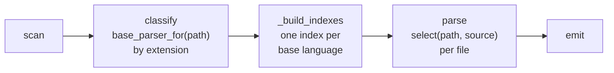
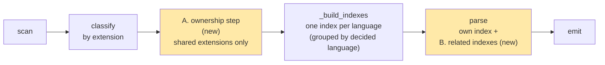
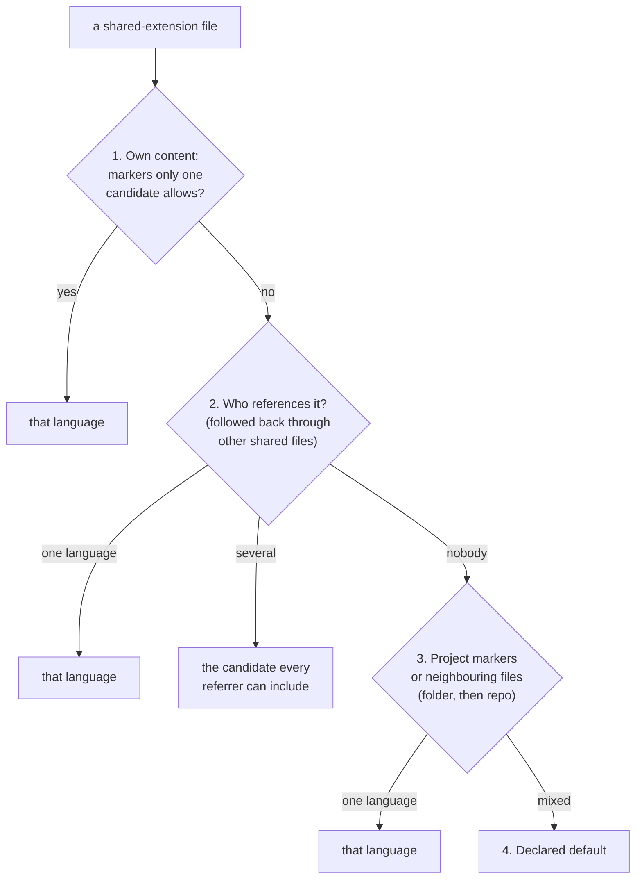
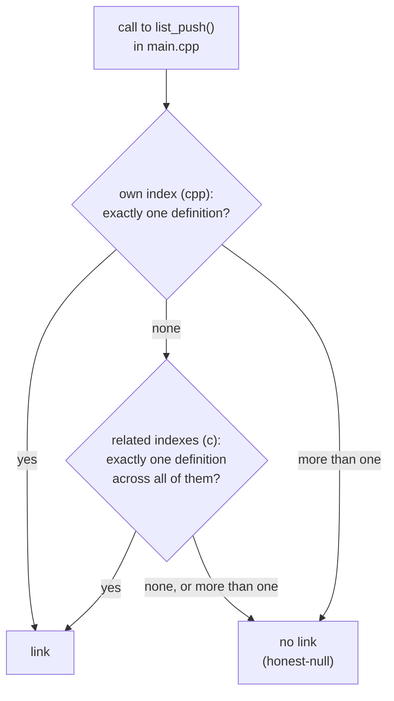

# Proposal: Shared Extensions and Related Languages

**Status:** proposal, not implemented. It changes `core/`, so it is an architectural change
(see [architecture §15](../architecture.md#15-code-layout-and-layering)).

Adding a C parser exposes two gaps in how cog picks a parser and resolves names:

1. **Which language owns a `.h` file?** C, C++ and Objective-C all use `.h`. Today an extension
   belongs to exactly one language.
2. **How does a C++ file link to a C function?** Each language has its own index, and a parser
   sees only its own.

This page proposes two small, independent mechanisms that close both gaps. Each is written once
in core and works for any language that needs it, not just C.

Paths below are relative to `src/breezeai_cog/`.

**Contents**

1. [How it works today](#1-how-it-works-today)
2. [The problem](#2-the-problem)
3. [Proposal overview](#3-proposal-overview)
4. [Mechanism A: the ownership step](#4-mechanism-a-the-ownership-step)
5. [Mechanism B: related languages](#5-mechanism-b-related-languages)
6. [How C and C++ link, end to end](#6-how-c-and-c-link-end-to-end)
7. [Who else can use this](#7-who-else-can-use-this)
8. [What changes in the code](#8-what-changes-in-the-code)
9. [Risks and costs](#9-risks-and-costs)
10. [Alternatives considered](#10-alternatives-considered)
11. [Delivery plan](#11-delivery-plan)
12. [Open questions](#12-open-questions)

---

## 1. How it works today



Three facts shape everything in this proposal:

- **An extension belongs to one base language.** `registry.base_parser_for(path)` returns the
  lowest-priority parser registered for the extension. It sets the file's `language` and the
  index the file goes into. Framework parsers (Spring, Express, Laravel …) sit above their base
  language at a higher priority and win through `claims()`.
- **Every decision is per file.** `claims(path, source)` sees one file. It cannot see which
  other files include or reference it.
- **A parser sees only its own language's index.** `_build_indexes` groups files by base
  parser name, and each worker gets one index as `ctx.resolution_index`
  ([cross-file resolution §3](cross-file-resolution.md#3-repo-wide-indexes-build_index)). The
  only bridge is a registered fact whose `FactSpec.sources` lets a language's index *read*
  files another parser owns.

Every extension registered by more than one parser today is one base language plus its framework
parsers (`.ts`, `.java`, `.php`, `.cs` …). **No extension is owned by two different base
languages.** `.h` would be the first.

---

## 2. The problem

The rest of this page uses this example repo:

```
repo/
├── lib/list.c      C: defines list_push()
├── lib/list.h      C API, wrapped in extern "C" guards
└── app/main.cpp    C++: #include "list.h", calls list_push()
```

### 2.1 Two parsers, one extension

If a C parser registers `.h` next to the C++ parser, both are base parsers at priority 0:

```
parsers_for("lib/list.h") = [CppParser(p0), CParser(p0)]
   base_parser_for → tie → whichever registered first
   select          → tie → whichever registered first
```

**Every** header in every repo gets the same answer, chosen by registration order. Looking
inside the file doesn't settle it either: most headers are valid C *and* valid C++. The right
answer depends on **which files include the header**, and a per-file `claims()` can't see that.

### 2.2 Separate indexes

Even with `.c` files parsed, they would go into a separate C index:

```
C++ index: main.cpp, list.h          C index: list.c
     │                                    ▲
     └─ main.cpp looks up list_push ──────┘   ✗ C++ parser can't see the C index
```

The call from `main()` to `list_push()` stays unlinked.

---

## 3. Proposal overview

There are two mechanisms, and each answers one question:

| Mechanism | Question it answers | Needed for C |
|---|---|---|
| **A. Ownership step** | Whose file is this? | `.h` |
| **B. Related languages** | Where else can I look up a name? | C++ → C calls |

They are independent. `.h` needs both. Most other cases need only one (see
[§7](#7-who-else-can-use-this)).



**What doesn't change:**
- One file is still parsed by exactly one parser.
- The capture format: no new field or value. `File.language` already records the language of
  each end of a link.
- Languages that don't use either mechanism (Python, Go, PHP …) behave exactly as before.

### Where this fits

This isn't a new kind of parser. Cog has three kinds today: **language parsers** (own the
extension, parse the file, build the index), **framework parsers** (sit above a language at a
higher priority and win through `claims()`), and **additive detectors** (run inside a language's
parse and add statements or facts). Neither mechanism parses a file or emits anything. Both are
optional capabilities of the **language parser**, plus one new pipeline stage in core.

```
┌──────────────────────────────────────────────────────────────┐
│ LANGUAGE PARSER                                              │
│  • extensions, build_index           (existing)              │
│  • ownership plug-in                 (new, optional)   ◀── A │
│  • related_languages                 (new, optional)   ◀── B │
│                                                              │
│   framework parsers   → receive the related indexes too      │
│   additive detectors  → receive the related indexes too      │
└──────────────────────────────────────────────────────────────┘
┌──────────────────────────────────────────────────────────────┐
│ CORE PIPELINE                                                │
│  scan → [ownership step] → build indexes → parse → emit      │
└──────────────────────────────────────────────────────────────┘
```

| Piece | What it is | Closest existing equivalent |
|---|---|---|
| Ownership plug-in | Optional settings on a language parser | `build_index`: optional, provided only by languages that need it |
| `related_languages` | Optional setting on a language parser | `extensions`: a value the parser declares |
| Ownership step | A pipeline stage in core | `_build_indexes`: runs once before parsing and uses the language parsers' settings |

Both belong to the language because ownership and indexes are per language. C++ owns `.h`, not
the Qt framework parser. Once the step has decided a file's language, that language's framework
parsers apply on top by priority as usual, and they get the related indexes through `ctx` without
declaring anything.

What each author does:

| Adding a… | Does |
|---|---|
| Language parser | May set `related_languages`; may provide an ownership plug-in if it registers an extension another language also registers |
| Framework parser | Nothing new; reads `ctx.related_indexes` if it needs to |
| Additive detector | Nothing new; reads `ctx.related_indexes` if it needs to |

> **Decision —** both mechanisms are capabilities of the language parser, not a fourth kind of
> parser.
> **Why:** they decide which language a file belongs to and where that language looks up names.
> Neither parses or emits anything, so a new kind of parser would have no work of its own.
> **Cost:** the `BaseParser` contract grows by two optional settings.

---

## 4. Mechanism A: the ownership step

### 4.1 Where it runs

The step runs once, after the scan and before indexing, and only for files whose extension is
registered by **more than one base language**. Every other file is classified by extension, as
it is today.

```
scan ──▶ classify by extension ──▶ ownership step ──▶ build indexes ──▶ parse
         .c   → c                       │
         .cpp → cpp                     │
         .h   → shared: c / cpp ────────┘──▶  table { path → language }
```

The step doesn't parse anything. It does a quick text scan of the candidate languages' files
for two things: **references** (such as `#include` lines) and a few **content markers**.

### 4.2 The rules

Each shared file goes through the rules in order. The first rule with a clear answer wins.



**Rule 1: the file's own content.** For example, `class`, `namespace` or `template` outside an
`#ifdef __cplusplus` block means C++. `@interface` means Objective-C. `#ifdef __cplusplus` blocks
are ignored because plain C headers use them too.

```c
// lib/list.h: no C++-only syntax outside the guard → rule 1 doesn't decide
#ifdef __cplusplus
extern "C" {
#endif
void list_push(List *l, int x);
```

**Rule 2: who references it.** The C and C++ parsers report `#include "x.h"`. The step resolves
each reference to a repo file and records who includes whom. A header included only by another
header is followed back to the real source files (`main.cpp → api.h → list.h` counts as
`main.cpp` including `list.h`).

| Included by | Decision |
|---|---|
| only C files | C |
| only C++ files | C++ |
| both | **C**: C++ can include a C header, but C can't include a C++ one |

"Both → C" isn't hard-coded. Each language declares which candidate languages it can include
(`cpp` declares it can include `c`). The rule picks the candidate that **every** referring
language can include.

**Rule 3: project markers and neighbours.** For a header nobody includes, the step looks for a
declared project marker, then at the languages of the other source files in the same folder,
then in the whole repo.

**Rule 4: default.** If nothing decides it, the step uses the default declared for the
extension. For `.h` that's C++, because its grammar reads most C. This is the only rule that is
a choice rather than something read from the code.

> **Decision —** a shared-extension file's language is decided from evidence across the whole
> repo, in a fixed rule order, before indexing.
> **Why:** the evidence that settles `.h` (who includes it) isn't inside the file, so a per-file
> `claims()` can't settle it. A fixed order gives the same answer every run. **Cost:** an extra
> text scan of the candidate languages' files, and a header's language can change when files
> that include it are added or removed.

> **Decision —** references that don't match a repo file (`<stdio.h>`), or that match more than
> one, are ignored by rule 2.
> **Why:** the same honest-null rule as everywhere else: a reference cog can't pin down isn't
> evidence. **Cost:** some headers fall through to rules 3 and 4.

### 4.3 What it produces

A table, built once, picklable and read-only:

| File | Language | Decided by |
|---|---|---|
| `lib/list.h` | c | rule 2 |
| `app/view.h` | cpp | rule 1 |
| `lib/stack.h` | c | rule 3 |
| `misc/old.h` | cpp | rule 4 |

Every later step reads it: the language label in the capture, the index the file joins, and the
parser that reads it. `select()` limits the candidates to parsers of the decided language, so
framework parsers on top of that language still apply by priority.

The rule that decided each file is logged at debug level so a wrong decision can be traced.

### 4.4 What a language plugs in

Core owns the rule order and the table. Each language that registers a shared extension supplies
only the evidence that applies to it:

| Plug-in | C | C++ | Objective-C (future) |
|---|---|---|---|
| Content markers | (none, C is the plain case) | `class`, `namespace`, `template`, `::` | `@interface`, `@protocol`, `#import` |
| References it reports | `#include "…"` | `#include "…"` | `#import "…"`, `#include "…"` |
| Languages it can include | `c` | `c`, `cpp` | `c`, `objc` |
| Project markers | — | — | `*.xcodeproj` |
| Default for an extension | — | `.h` | — |

A language that doesn't register a shared extension supplies nothing.

---

## 5. Mechanism B: related languages

### 5.1 The idea

A parser declares the languages whose indexes it may look into:

```python
class CppParser(BaseParser):
    name = "cpp"
    related_languages = ("c",)        # C++ calls C functions

class CParser(BaseParser):
    name = "c"
    related_languages = ("cpp",)      # only C++ functions marked extern "C"
```

The pipeline already builds every language's index. The only new work is passing the related
ones to the worker:

```
ParseContext
  resolution_index = own index                 (unchanged)
  related_indexes  = {"c": <C index>}          (new; empty when nothing is related)
```

### 5.2 Lookup order



> **Decision —** each language keeps its own index, and a parser looks in its related languages'
> indexes only after its own.
> **Why:** existing indexes and the code that builds them stay unchanged. A name that resolves
> in the caller's own language today keeps resolving the same way, so merging languages can't
> introduce new clashes that lose existing links. **Cost:** a parser must know how to read each
> related index it declares (for example, Kotlin reads `JavaIndex.fqcn`).

> **Decision —** `related_languages` is a parser setting, not a capture field.
> **Why:** the backend needs no new information. Each end of a link is a real node, and its file
> already carries `language`. **Cost:** none for the backend. If a cross-runtime binding later
> needs its own marker on the edge (see [§7.3](#73-bindings-between-runtimes-later)), that
> marker is proposed separately.

### 5.3 The list can be one-way

| Parser | Looks into | Why |
|---|---|---|
| C++ | C | C++ can call any C function |
| C | C++ | only C++ functions marked `extern "C"`, which the C++ index must flag |
| Kotlin | Java | Kotlin calls Java classes |
| Java | Kotlin | Java calls Kotlin classes |
| TypeScript | (JavaScript is already the same parser) | — |

### 5.4 It's separate from mechanism A

| Problem | Solved by |
|---|---|
| Is `list.h` C or C++? | A. ownership step |
| C++ calls a function defined in a C file | B. related languages |
| Kotlin calls a Java class | B only |
| `.cls` is Apex or VB6? | A only |

---

## 6. How C and C++ link, end to end

```
1. Ownership step     list.h is included by list.c and main.cpp  →  c
2. Build indexes      C index:   list_push → lib/list.c    (definitions)
                                 "list.h"  → lib/list.h    (include map)
                      C++ index: main      → app/main.cpp
3. Parse main.cpp     call list_push(l, 5)
                        own index (cpp)        → not found
                        related index (c)      → lib/list.c, exactly once
                      → edge  main()  ──calls──▶  list_push()
```

Matching by plain name is correct between C and C++ because `extern "C"` turns off C++ name
mangling. The rules:

| Caller | Callee | Link only if |
|---|---|---|
| C++ | C function | the name has exactly one definition |
| C | C++ function | exactly one definition **and** it is inside `extern "C"` |
| C | C function | the name has exactly one definition (normal rule) |
| C++ | C++ function | existing C++ rules (classes, namespaces) |

> **Decision —** `static` (file-private) C functions are never put in the definitions table.
> **Why:** another file can't call them. Indexing them would link a call to a same-named
> function the caller can't reach, which is a wrong edge. **Cost:** none.

---

## 7. Who else can use this

### 7.1 Shared extensions (mechanism A)

| Extension | Candidates | Evidence that decides it |
|---|---|---|
| `.h` | C, C++, Objective-C | own content, then who includes it |
| `.inc` | PHP, C, Pascal, assembly | who includes it (`include 'x.inc'`, `#include`) |
| `.cls` | Apex, VB6, LaTeX | project markers (`sfdx-project.json` → Apex) |
| `.m` | Objective-C, MATLAB | own content; project markers (`*.xcodeproj`) |
| `.mm` | Objective-C++, FreeMind (XML) | own content |
| `.pl`, `.v`, `.cl` | Perl/Prolog, Verilog/Coq, OpenCL/Lisp | own content |

There are three kinds of evidence. Cog can already handle the first:

| Evidence | Handled by |
|---|---|
| Own content only | **Existing** `claims(path, source)` and priority |
| Who references it | Ownership step (new) |
| Project markers | Ownership step (new) |

Only `.h` needs the ownership step today. `.inc`, `.cls` and `.m` need it only if cog adds the
competing languages (VB6, MATLAB, Pascal).

### 7.2 Related languages (mechanism B)

| Family | Members | What it would link |
|---|---|---|
| C | C, C++, Objective-C, CUDA | calls across C-family files |
| JVM | Java, Kotlin, Scala, Groovy | Kotlin calling a Java class and the reverse; Java and Kotlin indexes already share the same `fqcn` shape |
| .NET | C#, VB.NET | calls across a mixed solution; the VB index already matches a slice of the C# index |

The JVM and .NET benefits are **expected, not yet measured**. Each parser receives only its own
index today, so cross-language calls in these families are probably unlinked. That should be
confirmed on a real capture before those families adopt the mechanism.

### 7.3 Bindings between runtimes (later)

Calls between languages that don't share linkage follow naming conventions:

| Binding | Convention |
|---|---|
| JNI | Java `native void push()` in `com.acme.List` ↔ C `Java_com_acme_List_push` |
| C# P/Invoke | `[DllImport("lib")] extern void f()` ↔ C `f` |
| cgo | `C.foo()` in Go ↔ C `foo` |
| Python C extension | `PyMethodDef` table entry ↔ C function |

These belong to the existing registered-fact mechanism, extended so a language can **publish** a
fact (the C family's exported functions) that another language's detector **reads**. They are
out of scope for this proposal. If an edge across runtimes needs to be marked as such, that marker
is a new `semanticType` value and goes through the normal proposal process.

---

## 8. What changes in the code

| Area | Change |
|---|---|
| `parsers/base.py` | `BaseParser.related_languages = ()`; optional ownership plug-in (content markers, references, includable languages, project markers, extension defaults); `ParseContext.related_indexes` |
| `core/registry.py` | find extensions registered by more than one base language; `base_parser_for` and `select` use the ownership table for those files |
| `core/pipeline.py` | run the ownership step after the scan; `_build_indexes` groups by decided language; pass each parser its related indexes |
| `core/` (new module) | the ownership step: the text scan (parallel, same `--jobs`), the rule order, the table |
| `parsers/c/` (new) | the C parser, on the tree-sitter C grammar |
| shared C-family module | extraction helpers shared by C and C++; moving them out of `parsers/cpp/` needs a before/after C++ capture diff |
| `parsers/cpp/` | ownership plug-in; flag `extern "C"` definitions in the index; read the C index |

Two interactions with existing options:

- **`--language c`.** The ownership step still reads the other candidate languages' files to
  decide headers. It only emits the selected language.
- **Worker hand-off.** The ownership table and related indexes travel to workers the same way the
  indexes do today ([architecture §4.5](../architecture.md#45-parallel-execution)).

---

## 9. Risks and costs

| Risk | Severity | Mitigation |
|---|---|---|
| **Name-only matching links the wrong C function.** Cog doesn't read Makefiles or CMake, so a name defined once in `server/` can be linked from `client/`, which never links against it | **High** | Exactly-one-definition rule; prefer a definition whose header the caller includes; leave `static` functions out of the index |
| Header language decided wrongly, or changing between runs as includers change | Medium | Fixed rule order; decision logged per file |
| Existing captures change: headers labelled `cpp` today may become `c` | Medium | Call it out in the release notes; re-onboard affected repos |
| Core change touches every parser | Medium | Before/after capture diff across all languages; no behaviour change for parsers that don't opt in |
| Reuse beyond C is unproven | Medium | Implement only the C-family plug-ins now; measure JVM and .NET before adopting |
| Macros, function pointers and both branches of `#ifdef` stay unresolved or over-linked | Low (expected for C) | Documented as known limitations |
| Extra scan time and memory | Low | Text scan only, parallel; runs only when a shared extension is present |

---

## 10. Alternatives considered

| Alternative | Why not chosen |
|---|---|
| **Decide `.h` in `claims()` by content only** | Most headers are valid C and C++, so content alone can't decide them, and both parsers would claim them |
| **One combined C/C++ parser** that picks a grammar per file and keeps one internal index | No core change and no risk to other languages, but it fits only C/C++. `.inc`, `.cls` and the JVM and .NET families would each need their own solution. It remains the fallback if the core change is judged too risky |
| **One merged index per family** | Needs a new combined index format per family and a rewrite of each member's index. Merged tables also create new name clashes, which turn links that resolve today into honest-nulls |
| **A capture field naming the related language family** | The backend gains nothing: each end of a link already carries its file's `language`. It would also need a spec proposal and a backend allow-list change |

---

## 11. Delivery plan

1. **Core mechanisms, no new language.** Add the ownership step and `related_languages`. With no
   parser opting in, a capture diff across every language must show **no change**.
2. **C parser.** Add `parsers/c/` and the C/C++ ownership plug-ins. Move the shared extraction
   helpers, with a before/after C++ capture diff. Add C++ → C and `extern "C"` lookups.
3. **Later, on evidence.** Measure cross-language calls on JVM and .NET captures; adopt
   `related_languages` there if links are missing. Cross-runtime bindings (§7.3) follow as their
   own proposal.

---

## 12. Open questions

1. Is "included by both C and C++ → C" the right rule 2 outcome, as derived from
   "languages it can include"?
2. Should the rule 4 default for `.h` be C++, or should a header that nothing decides be
   left out of the capture?
3. Should the C → C++ `extern "C"` lookup ship in step 2, or wait until a real repo needs it?
4. Which JVM or .NET repos should be used to measure missing cross-language calls before step 3?
