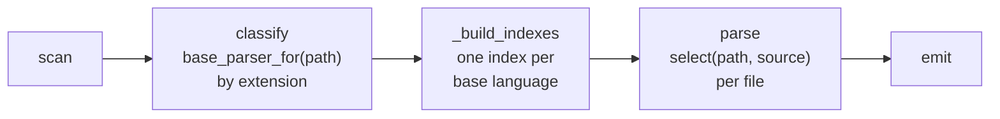
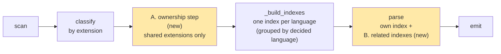
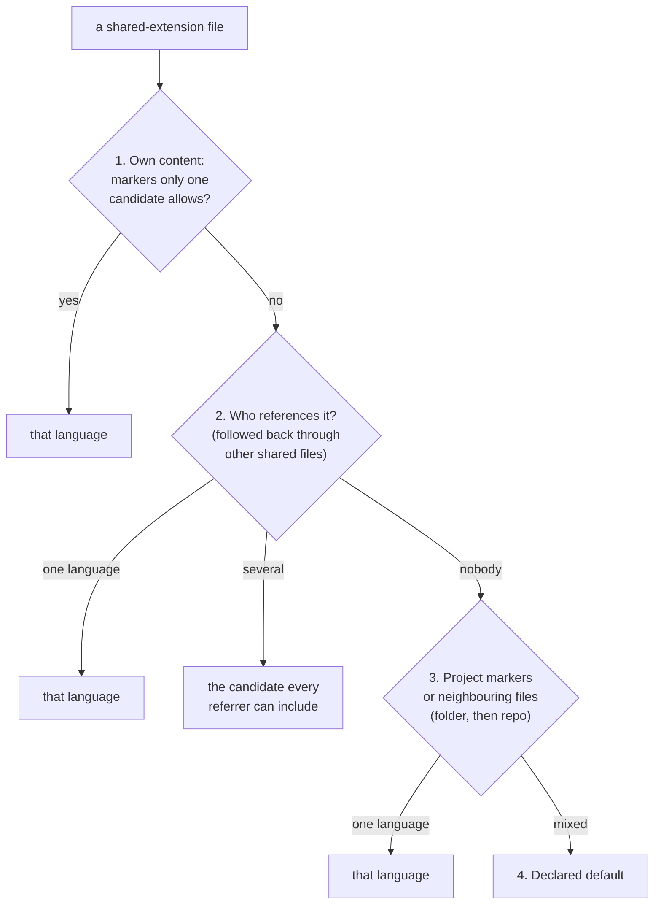
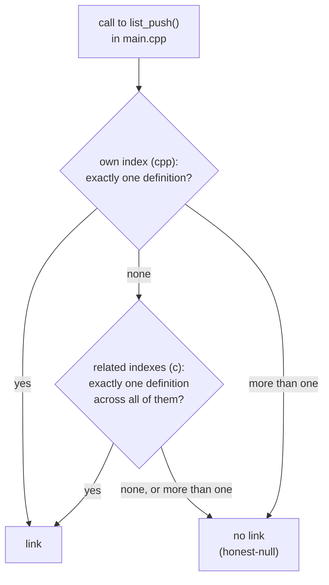

# Shared Extensions and Related Languages

**Status:** implemented for C and C++ (steps 1 and 2 of the [delivery plan](#11-delivery-plan)).
It changed `core/`, so it is an architectural change
(see [architecture §15](../architecture.md#15-code-layout-and-layering)).

Adding a C parser exposed two gaps in how cog picks a parser and resolves names:

1. **Which language owns a `.h` file?** C, C++ and Objective-C all use `.h`. Until then an
   extension belonged to exactly one language.
2. **How does a C++ file link to a C function?** Each language has its own index, and a parser
   sees only its own.

This page describes the two small, independent mechanisms that close both gaps. Each is written once
in core and works for any language that needs it, not just C.

Paths below are relative to `src/breezeai_cog/`.

**Contents**

1. [How it worked before](#1-how-it-worked-before)
2. [The problem](#2-the-problem)
3. [Overview](#3-overview)
4. [Mechanism A: the ownership step](#4-mechanism-a-the-ownership-step)
5. [Mechanism B: related languages](#5-mechanism-b-related-languages)
6. [How C and C++ link, end to end](#6-how-c-and-c-link-end-to-end)
7. [Who else can use this](#7-who-else-can-use-this)
8. [What changes in the code](#8-what-changes-in-the-code)
9. [Risks and costs](#9-risks-and-costs)
10. [Alternatives considered](#10-alternatives-considered)
11. [Delivery plan](#11-delivery-plan)
12. [Open questions](#12-open-questions)

---

## 1. How it worked before



Three facts shape everything in this proposal:

- **An extension belongs to one base language.** `registry.base_parser_for(path)` returns the
  lowest-priority parser registered for the extension. It sets the file's `language` and the
  index the file goes into. Framework parsers (Spring, Express, Laravel …) sit above their base
  language at a higher priority and win through `claims()`.
- **Every decision is per file.** `claims(path, source)` sees one file. It cannot see which
  other files include or reference it.
- **A parser sees only its own language's index.** `_build_indexes` groups files by base
  parser name, and each worker gets one index as `ctx.resolution_index`
  ([cross-file resolution §3](cross-file-resolution.md#3-repo-wide-indexes-build_index)). The
  only bridge is a registered fact whose `FactSpec.sources` lets a language's index *read*
  files another parser owns.

Every extension registered by more than one parser today is one base language plus its framework
parsers (`.ts`, `.java`, `.php`, `.cs` …). **No extension is owned by two different base
languages.** `.h` would be the first.

---

## 2. The problem

The rest of this page uses this example repo:

```
repo/
├── lib/list.c      C: defines list_push()
├── lib/list.h      C API, wrapped in extern "C" guards
└── app/main.cpp    C++: #include "list.h", calls list_push()
```

### 2.1 Two parsers, one extension

If a C parser registers `.h` next to the C++ parser, both are base parsers at priority 0:

```
parsers_for("lib/list.h") = [CppParser(p0), CParser(p0)]
   base_parser_for → tie → whichever registered first
   select          → tie → whichever registered first
```

**Every** header in every repo gets the same answer, chosen by registration order. Looking
inside the file doesn't settle it either: most headers are valid C *and* valid C++. The right
answer depends on **which files include the header**, and a per-file `claims()` can't see that.

### 2.2 Separate indexes

Even with `.c` files parsed, they would go into a separate C index:

```
C++ index: main.cpp, list.h          C index: list.c
     │                                    ▲
     └─ main.cpp looks up list_push ──────┘   ✗ C++ parser can't see the C index
```

The call from `main()` to `list_push()` stays unlinked.

---

## 3. Overview

There are two mechanisms, and each answers one question:

| Mechanism | Question it answers | Needed for C |
|---|---|---|
| **A. Ownership step** | Whose file is this? | `.h` |
| **B. Related languages** | Where else can I look up a name? | C++ → C calls |

They are independent. `.h` needs both. Most other cases need only one (see
[§7](#7-who-else-can-use-this)).



**What doesn't change:**
- One file is still parsed by exactly one parser.
- The capture format: no new field or value. `File.language` already records the language of
  each end of a link.
- Languages that don't use either mechanism (Python, Go, PHP …) behave exactly as before.

### Where this fits

This isn't a new kind of parser. Cog has three kinds today: **language parsers** (own the
extension, parse the file, build the index), **framework parsers** (sit above a language at a
higher priority and win through `claims()`), and **additive detectors** (run inside a language's
parse and add statements or facts). Neither mechanism parses a file or emits anything. Both are
optional capabilities of the **language parser**, plus one new pipeline stage in core.

```
┌──────────────────────────────────────────────────────────────┐
│ LANGUAGE PARSER                                              │
│  • extensions, build_index           (existing)              │
│  • ownership plug-in                 (new, optional)   ◀── A │
│  • related_languages                 (new, optional)   ◀── B │
│                                                              │
│   framework parsers   → receive the related indexes too      │
│   additive detectors  → receive the related indexes too      │
└──────────────────────────────────────────────────────────────┘
┌──────────────────────────────────────────────────────────────┐
│ CORE PIPELINE                                                │
│  scan → [ownership step] → build indexes → parse → emit      │
└──────────────────────────────────────────────────────────────┘
```

| Piece | What it is | Closest existing equivalent |
|---|---|---|
| Ownership plug-in | Optional settings on a language parser | `build_index`: optional, provided only by languages that need it |
| `related_languages` | Optional setting on a language parser | `extensions`: a value the parser declares |
| Ownership step | A pipeline stage in core | `_build_indexes`: runs once before parsing and uses the language parsers' settings |

Both belong to the language because ownership and indexes are per language. C++ owns `.h`, not
the Qt framework parser. Once the step has decided a file's language, that language's framework
parsers apply on top by priority as usual, and they get the related indexes through `ctx` without
declaring anything.

What each author does:

| Adding a… | Does |
|---|---|
| Language parser | May set `related_languages`; may provide an ownership plug-in if it registers an extension another language also registers |
| Framework parser | Nothing new; reads `ctx.related_indexes` if it needs to |
| Additive detector | Nothing new; reads `ctx.related_indexes` if it needs to |

> **Decision —** both mechanisms are capabilities of the language parser, not a fourth kind of
> parser.
> **Why:** they decide which language a file belongs to and where that language looks up names.
> Neither parses or emits anything, so a new kind of parser would have no work of its own.
> **Cost:** the `BaseParser` contract grows by two optional settings.

---

## 4. Mechanism A: the ownership step

### 4.1 Where it runs

The step runs once, after the scan and before indexing, and only for files whose extension is
registered by **more than one base language**. Every other file is classified by extension, as
it is today.

```
scan ──▶ classify by extension ──▶ ownership step ──▶ build indexes ──▶ parse
         .c   → c                       │
         .cpp → cpp                     │
         .h   → shared: c / cpp ────────┘──▶  table { path → language }
```

The step doesn't parse anything. It does a quick text scan of the candidate languages' files
for two things: **references** (such as `#include` lines) and a few **content markers**.

### 4.2 The rules

Each shared file goes through the rules in order. The first rule with a clear answer wins.



**Rule 1: the file's own content.** For example, `class`, `namespace` or `template` outside an
`#ifdef __cplusplus` block means C++. `@interface` means Objective-C. `#ifdef __cplusplus` blocks
are ignored because plain C headers use them too.

```c
// lib/list.h: no C++-only syntax outside the guard → rule 1 doesn't decide
#ifdef __cplusplus
extern "C" {
#endif
void list_push(List *l, int x);
```

**Rule 2: who references it.** The C and C++ parsers report `#include "x.h"`. The step resolves
each reference to a repo file and records who includes whom. A header included only by another
header is followed back to the real source files (`main.cpp → api.h → list.h` counts as
`main.cpp` including `list.h`).

| Included by | Decision |
|---|---|
| only C files | C |
| only C++ files | C++ |
| both | **C**: C++ can include a C header, but C can't include a C++ one |

"Both → C" isn't hard-coded. Each language declares which candidate languages it can include
(`cpp` declares it can include `c`). The rule picks the candidate that **every** referring
language can include.

**Rule 3: neighbours.** For a header nobody includes, the step looks at the languages of the
other files in the same folder, then in the whole repo: source files, and headers that rules 1–2
already decided. A public header that nothing includes, in an `include/` folder of headers that C
files include, is C. Rules 3–4 read only those settled files, never each other's results, so the
outcome doesn't depend on the order files are visited. (Project markers such as
`sfdx-project.json` belong in this rule too. No current language needs them, so they are added
with the first one that does.)

**Rule 4: default.** If nothing decides it, the step uses the default declared for the
extension. For `.h` that's C++, because its grammar reads most C. This is the only rule that is
a choice rather than something read from the code.

> **Decision —** a shared-extension file's language is decided from evidence across the whole
> repo, in a fixed rule order, before indexing.
> **Why:** the evidence that settles `.h` (who includes it) isn't inside the file, so a per-file
> `claims()` can't settle it. A fixed order gives the same answer every run. **Cost:** an extra
> text scan of the candidate languages' files, and a header's language can change when files
> that include it are added or removed.

> **Decision —** references that don't match a repo file (`<stdio.h>`), or that match more than
> one, are ignored by rule 2.
> **Why:** the same honest-null rule as everywhere else: a reference cog can't pin down isn't
> evidence. **Cost:** some headers fall through to rules 3 and 4.

### 4.3 What it produces

A table, built once, picklable and read-only:

| File | Language | Decided by |
|---|---|---|
| `lib/list.h` | c | rule 2 |
| `app/view.h` | cpp | rule 1 |
| `lib/stack.h` | c | rule 3 |
| `misc/old.h` | cpp | rule 4 |

Every later step reads it: the language label in the capture, the index the file joins, and the
parser that reads it. `select()` limits the candidates to parsers of the decided language, so
framework parsers on top of that language still apply by priority.

The rule that decided each file is logged at debug level so a wrong decision can be traced.

### 4.4 What a language plugs in

Core owns the rule order and the table. Each language that registers a shared extension supplies
only the evidence that applies to it:

| `Ownership` field | C | C++ | Objective-C (future) |
|---|---|---|---|
| `proves` (rule 1) | — (C is the plain case) | `class Name {`, `namespace`, `using namespace`, `template <`, `std::`, `extern "C"`, `#include <vector>` | `@interface`, `@protocol` |
| `references` (rule 2) | `#include "…"` | `#include "…"` | `#import "…"`, `#include "…"` |
| `includes` (rule 2) | — | `c` | `c` |
| `default_for` (rule 4) | — | `.h` | — |

A language that doesn't register a shared extension supplies nothing. Both languages read a
file's includes with `parsers/cfamily_common/imports.py::include_targets`; C++'s proof lives in
`parsers/cpp/ownership.py`. Comments and string literals never count. Inside an `#if`
group that tests `__cplusplus`, a C API header routinely has its `extern "C" {` guard and C++
includes (`<cstddef>`); those are not proof. A C++ *declaration* there (`namespace`, `class`,
`template <`, `std::`) is: such a header is written for both languages, and only the C++ grammar
reads all of it, where the C grammar would lose its C++ declarations.

---

## 5. Mechanism B: related languages

### 5.1 The idea

A parser declares the languages whose indexes it may look into:

```python
class CppParser(BaseParser):
    name = "cpp"
    related_languages = ("c",)        # C++ calls C functions

class CParser(BaseParser):
    name = "c"
    related_languages = ("cpp",)      # only C++ functions marked extern "C"
```

The pipeline already builds every language's index. The only new work is passing the related
ones to the worker:

```
ParseContext
  resolution_index = own index                 (unchanged)
  related_indexes  = {"c": <C index>}          (new; empty when nothing is related)
```

### 5.2 Lookup order



> **Decision —** each language keeps its own index, and a parser looks in its related languages'
> indexes only after its own.
> **Why:** existing indexes and the code that builds them stay unchanged. A name that resolves
> in the caller's own language today keeps resolving the same way, so merging languages can't
> introduce new clashes that lose existing links. **Cost:** a parser must know how to read each
> related index it declares (for example, Kotlin reads `JavaIndex.fqcn`).

> **Decision —** `related_languages` is a parser setting, not a capture field.
> **Why:** the backend needs no new information. Each end of a link is a real node, and its file
> already carries `language`. **Cost:** none for the backend. If a cross-runtime binding later
> needs its own marker on the edge (see [§7.3](#73-bindings-between-runtimes-later)), that
> marker is proposed separately.

### 5.3 The list can be one-way

| Parser | Looks into | Why |
|---|---|---|
| C++ | C | C++ can call any C function |
| C | C++ | only C++ functions marked `extern "C"`, which the C++ index must flag |
| Kotlin | Java | Kotlin calls Java classes |
| Java | Kotlin | Java calls Kotlin classes |
| TypeScript | (JavaScript is already the same parser) | — |

### 5.4 It's separate from mechanism A

| Problem | Solved by |
|---|---|
| Is `list.h` C or C++? | A. ownership step |
| C++ calls a function defined in a C file | B. related languages |
| Kotlin calls a Java class | B only |
| `.cls` is Apex or VB6? | A only |

---

## 6. How C and C++ link, end to end

```
1. Ownership step     list.h is included by list.c and main.cpp  →  c
2. Build indexes      C index:   list_push → lib/list.c    (definitions)
                                 "list.h"  → lib/list.h    (include map)
                      C++ index: main      → app/main.cpp
3. Parse main.cpp     call list_push(l, 5)
                        own index (cpp)        → not found
                        related index (c)      → lib/list.c, exactly once
                      → edge  main()  ──calls──▶  list_push()
```

Matching by plain name is correct between C and C++ because `extern "C"` turns off C++ name
mangling. The rules:

| Caller | Callee | Link only if |
|---|---|---|
| C++ | C function | the name has exactly one definition |
| C | C++ function | exactly one definition **and** it is inside `extern "C"` |
| C | C function | the name has exactly one definition (normal rule) |
| C++ | C++ function | existing C++ rules (classes, namespaces) |

`#include` resolves the same way across the two languages. Each index maps its own headers'
basenames, and a C++ file reads both maps as one (`cfamily_common/imports.py::FamilyHeaders`): a basename
resolves only when exactly one file in either language has it, as it did when every header was
C++.

> **Decision —** a `static` function defined in a file that is not a header is never a call
> target, but its name still counts as defined, so a same-named function elsewhere becomes
> ambiguous.
> **Why:** another file can't call it, so linking to it is a wrong edge. And because cog can't
> see which files a call can reach, a second definition of the name elsewhere is not assumed to
> be the one meant: a `run()` in an unrelated tool's header is not what `server.cpp`'s own
> `run()` calls. A `static inline` function in a header is different: every file that includes
> the header can call it, so it stays a target. **Cost:** a call to a global function that shares
> its name with an unrelated file-local one is left unresolved. A same-file call still resolves.
> This applies to C++ `.cpp` files too.

> **Decision —** a `static` free function has `isStatic: true`.
> **Why:** it is the keyword as written, and it is what tells an agent the function can't be
> called from another file. In Java or C# the same field marks a class-level member; a C
> function has no class, so on it the field can only mean file-local. **Cost:** a query on
> `isStatic` across languages mixes the two meanings.
>
> A C++ (or CUDA) static member function has `isStatic: true` where `static` is written: on its
> declaration or inline definition in the class. Its out-of-class definition (`Pool&
> Pool::instance() { … }`) can't repeat the keyword, so there it stays empty: the class is
> usually in another file.

> **Decision —** `typedef struct [tag] { … } name;` (also `union`, `enum`) is a class named
> `name`, with its fields or members; a tag that differs is the class's `alias`. A typedef
> without a body (`typedef struct node node_t;`) or without one plain name stays a
> `type_definition` statement.
> **Why:** this is C's usual way to declare a struct, and the typedef's name is the one code
> writes — where the two differ, redis, zlib and llama.cpp use it about 97% of the time — so
> a type written on a parameter leads to its class. The tag is a second name from the same
> declaration, so it belongs on the class: `name` holds the typedef name, `extends` means
> inheritance, a `type_definition` statement would repeat the whole struct body, and
> `metadata` can't be filtered on. **Cost:** a new `Class` field (`alias`, capture schema 2.4);
> the backend keeps it (`Class` is open) but doesn't embed it until it is added to the
> class's embedding text. The same applies to C-style typedefs in C++. An alias declared on
> its own (`using A = B;`, `typedef B A;`) stays a statement, as in every other language.

> **Decision —** a named struct, class, union or enum defined in the same declaration as a
> variable (`static struct config { int level; } cfg;`) is a class like any other definition,
> and the variable keeps its `declaration` statement; the index reads the class too. In a
> class, a member declared with its nested type (`struct node { … } root;`, `union { … } u;`)
> is a field statement beside the nested class. An anonymous type at file scope (`struct {
> … } cfg;`) has no name to give a class, and stays the variable's statement only.
> **Why:** C writes one-off globals this way (redis's `config`, `sentinelState`), and the class,
> its fields and its methods were lost; the members declared with their type were the only
> fields of a class that weren't captured. **Cost:** none known; naming an anonymous type after
> its variable would be a guess.

> **Decision —** a file-scope function prototype (`int list_len(const node_t *head);`) is a
> plain `declaration` statement named after the function, not a `Function`.
> **Why:** a C header's prototypes are its module's API, and nothing else captured them. A
> `Function` would duplicate the definition and, never being a call target, look unused. A
> prototype the grammar misreads — a macro such as `LUA_API` taken for the return type, which
> reads as a function returning a function — is skipped rather than named wrongly. **Cost:**
> statements aren't embedded, so a header isn't found by meaning from its prototypes; and
> macro-prefixed prototypes the grammar misreads are not captured.

> **Decision —** every macro definition is a statement (`preproc_def` / `preproc_function_def`)
> named after the macro, wherever it is written: at file scope, inside a function body or
> inside a class; never a `Function`, and a call to a macro stays unresolved.
> **Why:** cog doesn't run the preprocessor, so a macro has no body cog can read as code; the
> functions a macro wraps are captured where they are defined. Where a macro confuses the
> grammar, nothing is named from the confusion: `unsigned long ZEXPORT f()` has the return type
> `unsigned long` (a type name can't follow `unsigned` / `long` in C, so `ZEXPORT` is a macro);
> a declaration or definition with an error on the way to its name is skipped (`int f
> OF((int a, int b));` would be named `b`, `voidpf ZLIB_INTERNAL zcalloc(…)` would be a
> function named `ZLIB_INTERNAL`); a declaration whose parameter list has a parameter with no
> type is a macro call around the real one and is skipped (`local int gz_init OF((gz_statep));`
> reads as a function named `OF`; a typedef written that way keeps its statement, without a
> name); a keyword reserved in both C and C++ is never a declared name (`LOCALS` with no `;`
> before `if (a) {…}` reads as a variable `if`), so such a statement keeps its text without a
> name; and a row of macro calls the grammar reads as one function
> named after the macro (`GEN(a) GEN(b)` followed by a function) is not emitted. An error in an
> initializer, in a parameter list or after an initialized variable's name leaves the name
> intact. **Cost:** calls into macros have no `CALLS` edge; a function whose name the grammar
> lost is not captured.

> **Decision —** a declaration or definition with a macro in front is read past the macro in
> two shapes, and in no others: a macro in front of the type (`LUA_API int lua_gettop(…)`, read
> as the type `LUA_API` with `int` in an error) when the error is bare words between the type
> and a clean declarator; and a macro or type in front of the name (`LUALIB_API lua_Integer
> luaL_len(…)`, read as a function named `lua_Integer`) when the error is the one word right
> before the parameter list — in C, the word before a function's `(` is its name. The parser
> and the index read both the same way, so calls to these functions resolve. A C++ class member
> is read past a macro in front of its type by the same rule (`ESIMD_INLINE int row(int g)
> const`, `API static Model *load(…)`); any other broken member is still skipped. A macro the
> grammar folds into `unsigned` / `signed` / `long` / `short` (`LUALIB_API unsigned int f(…)`
> reads as the type `LUALIB_API unsigned` with `int` in an error) is read past the same way,
> when the error holds only type keywords.
> **Why:** export, inline and attribute macros sit in front of most public C functions (redis,
> lua, curl, zlib, llama.cpp); skipping them dropped thousands of functions and every call to
> them. In both shapes the name and parameters come from clean syntax. **Cost:** `returnType`
> is empty unless the words after the macro are C type keywords (`LUA_API int`, `LUA_API const
> char *`): `LUA_API lua_Integer` and `uLong ZEXPORT` parse the same way, so which word is the
> type can't be told.

> **Decision —** a name parenthesized after a macro and a type keyword (`LUA_API int
> (lua_gettop) (lua_State *L);`, Lua's guard against a macro of the same name) is recovered.
> The grammar reads it as a function named `int` that returns a function, which C and C++ never
> allow, so the tree is always a misreading. A type keyword can't be a name or a macro, so when
> the misread name is one and the inner parentheses hold one bare word, the word in front is
> the macro (a decorator), the keywords are the return type and the bare word is the name. The
> same holds for a class member, and the parser and the index read both the same way. Any
> other function-returning-function shape is skipped, at file scope and in a class alike. A
> parenthesized name read cleanly (`int (f)(int a) {…}`, `LUALIB_API lua_State *(luaL_newstate)
> (void) {…}`) is named without its parentheses, in the parser and the index alike.
> **Why:** Lua writes its whole API this way (lua.h, lauxlib.h, lualib.h, and every project that
> embeds it); the prototypes were lost and a definition was named `int (luaL_loadstring)`.
> **Cost:** a type name in front (`LUALIB_API lua_Integer (luaL_len)`) stays skipped: it is
> also how a type and a name-building macro look (`int MANGLE(f)(…)`), so the name would be a
> guess.

> **Decision —** a macro in front of a `struct` / `union` / `enum` return type (`UNITTEST struct
> stsentry *hsts_check(…)`, `GGML_API struct ggml_tensor * ggml_add(…);`) is the decorator, and
> the tagged type the `returnType` (`struct stsentry`). A tag type can't follow a type, so the
> word in front is the macro. C splits such a line into a broken `UNITTEST struct` (its `;`
> missing) and `stsentry *hsts_check(…)`; exactly that split is blanked in the shared second
> parse and kept only where the declaration then reads whole with the tagged type, and the
> macro is read back as the one word before the type that no node covers. C++ reads the macro as
> the type with `struct stsentry` in an error, and is read past as for a keyword type. The
> statement's `text` starts at the keyword.
> **Why:** the `returnType` was `stsentry`, a name C doesn't define (only `struct stsentry`), and
> the export macro on most of llama.cpp's and curl's struct-returning API was lost. **Cost:** in
> C such a file is parsed twice (sharing the class-head parse).

> **Decision —** a calling-convention or export macro between a keyword return type and the
> name (`int ZEXPORT unzOpen(…)`, `void WINAPI f(…)`, also in a K&R definition or a class
> member) is read past: the keyword type is the `returnType` and the macro the decorator. After
> a type made of keywords only the declarator can follow, so a bare word the grammar leaves in
> an error there, before a clean declarator, is a macro. A word between a `*` and the name
> (`const char * ZEXPORT zlibVersion(void)`, already captured) is that function's decorator for
> the same reason. With a type name in front (`uLong ZEXPORT adler32`) which word is the type
> still can't be told, as before.
> **Why:** the shape is how zlib, minizip and Windows-facing C export their API; those functions
> and prototypes were lost while the less certain `uLong ZEXPORT f` was kept. **Cost:** none —
> the tree is already there.

> **Decision —** a qualifier macro between a parameter's `*` and its name (`float *
> GGML_RESTRICT s`, `float ** FAR s`) is read past: the parameter is named `s`. The grammar
> takes the macro for the name and leaves the real name in an error right after the parameter;
> no `T * A B` is valid C or C++, so when that error holds one bare word before the next `,` or
> `)`, the word is the name. The parameter list then counts as clean for reading past a macro in
> front of the return type, and the parser, the variables a body can't call and the receiver
> types all use the same name. The macro itself is not captured (a parameter has no decorators).
> **Why:** restrict and pointer macros are standard in performance and portable C: llama.cpp
> had 1,330 parameters named `GGML_RESTRICT` or `RESTRICT`, and every `GGML_API` prototype with
> one was lost. **Cost:** none — the tree is already there. In C++ a definition whose
> parameters are all `Name * MACRO p` (a type name, no `const`) reads as a variable initialised
> with `Name * MACRO`; the next decision reads it.

> **Decision —** a C++ definition that a qualifier macro made read as a variable (`void
> unpack(tile_t * RESTRICT tile, const void * RESTRICT p) { … }`, read as `unpack` initialised
> with `tile_t * RESTRICT`, its body a stray block) is read from the shared second parse with
> the macros blanked. It happens when no parameter has an unambiguous type. A macro counts only
> in exactly that shape — a declaration initialised with an argument list and followed at once
> by `{ … }`, an `A * MACRO` argument followed by an error starting with the parameter's name —
> and the blank is kept only where a function definition with a clean header then starts there.
> **Why:** the whole function was lost. **Cost:** such a file is parsed twice (sharing the
> class-head parse); one case in the six repos sampled.

> **Decision —** a macro between `class` / `struct` / `union` and the class name (`class
> OPENVINO_API GatherMatmul : public Op { … }`) is blanked and the file is parsed a second
> time, so the class is read as if the macro weren't written. The word is blanked only where
> the grammar misread the class because of it: the head has no body and sits in a function
> definition or a broken declaration. The blank keeps the same length, so lines and byte offsets
> don't move, and names and text are still read from the original source. A class that still
> doesn't parse whole without the macro — another macro in its body breaks it — keeps the macro
> and stays uncaptured: read again, its head would sit in an error and its methods would read
> as free functions. The index parses the file the same way.
> **Why:** export macros (`OPENVINO_API`, Qt's `Q_CORE_EXPORT`, Chromium's `BASE_EXPORT`)
> sit there in most public headers of a C++ library. In C++ only an attribute can stand between
> `class` and the name, and attributes parse, so a bare word there is always such a macro. The
> grammar takes it for the class name and reads the class body as a function body
> (constructors as calls, `public:` as a label), which nothing can be recovered from safely;
> without the macro it is an ordinary class. **Cost:** such a file is parsed twice.

> **Decision —** a macro wrapped around a whole declaration (`DEPRECATED(LLAMA_API int
> llama_n_vocab(const struct llama_vocab * vocab), "use llama_vocab_n_tokens instead");`) is
> blanked in the same second parse as a class-head macro: `DEPRECATED(` and `, "…")` become
> spaces, and the declaration reads as written. A wrapper counts only outside a function body,
> with a first argument that ends in a parameter list, string literals (and comments) as its
> other arguments, and `;` right after it; the blank is kept only where it leaves one
> declaration, outside any error, running through that `;`. The wrapper is the declaration's
> decorator, with its strings as arguments (`DEPRECATED("use llama_vocab_n_tokens instead")`).
> The statement's `text` is the declaration's span, from its first word through the `;`.
> **Why:** the grammar can't read a declaration as a macro argument, and its error runs on over
> the clean declarations after the wrapper: llama.cpp's `llama.h` and `ggml.h` lost about 500
> of their 600 public prototypes. The notice is what an agent needs to know about a deprecated
> function. **Cost:** such a file is parsed twice (sharing the class-head parse).

> **Decision —** an attribute macro after a declaration's parameter list (`void errorf(const
> char *fmt, ...) CURL_PRINTF(1, 2);`, `int f(void) WARN_UNUSED_RESULT;`) is blanked in the same
> second parse, and becomes the declaration's decorator with its arguments. Such a macro
> expands to `__attribute__((…))`, which the grammar reads there, but as a macro it breaks the
> prototype (or, in a class, becomes a field named after the macro). A candidate is `NAME(…)`,
> or a bare word in capitals, between a `)` and `;`, outside a function body, where the grammar
> failed on it or cut the declaration before it short; the blank is kept only where the
> declaration then parses whole through that `;`. A K&R definition (`int f(a) int a;`) is not a
> candidate. The macro is read from the original source, between the declarator and the `;`.
> **Why:** printf-format and unused-result macros are common on C library prototypes: curl lost
> about 60 of its internal and public prototypes this way. **Cost:** such a file is parsed twice
> (sharing the class-head parse).

> **Decision —** a macro written as a whole member of a class or struct body
> (`OPENVINO_MATCHER_PASS_RTTI("…")`, jemalloc's `LOCKEDINT_MTX_DECLARE(mtx)`) is blanked in the
> same second parse. A line that is only `NAME(…)` has no `;` and no body, so it can't be a
> member: it is a macro that expands to members (or to nothing). It counts only where the
> grammar failed on it inside a class body (a field with an error, or an error holding the
> class keyword before it), outside a function body, after the end of a member, the body's `{`
> or an access label, and followed by the start of another member. A following `:`, `{`, `=`,
> `,`, `)`, a qualifier (`const`, `noexcept`, `override`, …), `->` or an attribute makes it a
> member written over two lines (`Foo(int a)` / `: a_(a) {}`), which is left alone. The blank
> is kept only where the line then sits in a class body outside any error and the member after
> it parses whole. The macro itself is not captured.
> **Why:** the grammar runs the line into the next member: the class is lost (llama.cpp's
> OpenVINO pass headers) or the macro and the next member become one field with a wrong name
> and type. **Cost:** such a file is parsed twice (sharing the class-head parse); a class that
> also has an export macro in its head is read only if the head alone is enough.

> **Decision —** an `extern "C"` guard the file's parse collapsed around is resolved as the
> compiler for the file's language would, in the same second parse. In `#ifdef __cplusplus` /
> `extern "C" {` / `#endif` … `#ifdef __cplusplus` / `}` / `#endif` the grammar reads both
> blocks, so `{` and `}` sit in separate conditionals; when more conditional code follows, its
> recovery fails and the whole file reads as one error, with only its comments captured.
> `__cplusplus` is defined exactly when a C++ compiler reads the file: for C++ and CUDA only the
> directive lines are blanked, so `extern "C" { … }` stays a block and its functions keep their C
> linkage; for C both guard blocks are blanked. Only a file with an error at file scope and one
> guard pair is touched, and the blank is kept only where no file-scope error is left over it.
> **Why:** curl's `curl.h` and llama.cpp's `mtmd.h`, `mtmd-helper.h` and `ggml-impl.h` captured
> nothing, and a guard around two vendor prototypes in `aclnn_ops.cpp` hid the 20 functions
> after it. **Cost:** other `__cplusplus`-only code is still read as both branches, as before.

> **Decision —** a function whose braces a preprocessor conditional splits is read from a second
> parse where the normal one gets its end wrong. When one `#ifdef` block opens a brace (`} else {`)
> and a later one closes it, the compiler sees both or neither, but the grammar reads both and
> can't match them: the body runs on into the functions after it (lost, their calls credited to
> it) or stops short. A file where a function body with a parse error holds a conditional is
> parsed again with each conditional resolved to its first branch — directive lines, later
> branches and `#if 0` blocks blanked, lines and offsets kept. Where both parses agree on where a
> function starts but not where it ends, the function is read from the second parse, and so is
> everything in the span the first one covered wrongly (functions, classes, declarations);
> everything else comes from the normal parse. The index and same-file call resolution read the file the same way.
> **Why:** the second parse is the compiler's view under one consistent configuration, so its
> braces match; it can't replace the normal parse, which captures both branches of a conditional
> (the second drops every `#else`-only definition), so it only settles where a function ends.
> **Cost:** the corrected function's calls in later branches are not captured, nor are
> `#else`-only definitions inside the span it had swallowed (before, none of them were).

> **Decision —** the same second parse also supplies what an error at file scope swallowed,
> when that error holds a conditional. An `else if` written inside an `#ifndef` (curl's
> `http.c`), or a split brace in a function, can turn everything after it — up to the end of a
> file-wide `#ifndef` — into one error the parser can't read, so no function is left to repair.
> The definitions and declarations the second parse finds inside that error's span are read from
> it; anything else it finds there, and anything it misread too (a `}` it had to insert, a brace
> lost in an error outside a function body), is not.
> **Why:** a file-wide error loses every function after the break: curl's `http.c` lost 102
> functions, llama.cpp's `ggml-hexagon.cpp` 190. The second parse reads that region as one build
> configuration would. **Cost:** as for split braces — the recovered region is read under the
> first branch of each conditional, and its `#else`-only definitions stay lost; a call in a
> recovered function is the one that configuration makes.

> **Decision —** a file whose whole parse is one error is read from the same second parse when
> that parse reads it without one. A conditional can make the grammar give up on the entire file
> (zlib's `inflate.c` splits an `if (` across `#ifdef GUNZIP` / `#else`); the functions after the
> break are lost, and the statements and locals of the broken ones read as file-scope
> declarations — 173 locals were captured as globals across nine such files. Each file- or
> namespace-scope node the second parse finds that the normal parse doesn't have as such
> (functions, classes, declarations, `#define`s, and only ones it read whole) is read from it, and
> the normal parse's nodes inside it are skipped; the normal parse's nodes outside every such
> node, an `#else`-only definition among them, stay. What the second parse supplies sits in its
> classes, so the spilled-member rule below doesn't apply to it.
> **Why:** the normal parse of such a file is wrong in places it can't tell, while the second
> parse reads it whole under one build configuration. **Cost:** as for split braces — one more parse
> for such a file (ten in the six repos sampled), and the first branch of each conditional.

> **Decision —** when a C++ or CUDA file can't be parsed as a whole and members of a class
> spilled out to file scope, only definitions that name their owner (`int Judge::decide()`)
> are captured from the file's flat scope; unqualified functions and declarations are not. The
> grammar then makes the file's root an `ERROR` holding every declaration flat, and the members
> of a class whose head was lost in it read as free functions. A definition that can only be a
> member proves the spill: a `field_identifier` name (the grammar's name for a member), an
> unqualified destructor, `operator=` / `->` / `()` / `[]`, or a definition with no return type
> (a constructor). Classes that parsed whole are kept, and the index and same-file call
> resolution skip the same definitions.
> **Why:** a member emitted as a free function of the file is a wrong owner and a wrong call
> target, and in the flat scope a member can't be told from a real free function by its name.
> **Cost:** real free functions in such a file are lost (in a large single-header library,
> a few free operators beside hundreds of members). Files that parse, and broken files without
> such proof — all broken C files among them — are read as before.

> **Decision —** C/C++ attributes and the macros cog reads past are `decorators` on the
> function, prototype, member or class, as annotations are in other languages: `[[nodiscard]]`,
> `[[deprecated("use g")]]`, `__attribute__((format(printf, 2, 3)))` and `__declspec(dllexport)`
> each give one decorator with its arguments, and an export or inline macro gives one with its
> name (`LUA_API`, `ZEXPORT`, `OPENVINO_API`). A macro is recorded only where it is certainly
> the macro: in front of a C type keyword (`LUA_API int f`), after `unsigned` / `long`
> (`unsigned long ZEXPORT crc32`), or between `class` and the class name.
> **Why:** the macro says how the code is built and exported (`GGML_API`, `CURL_EXTERN`), which
> is lost otherwise; `decorators` already carries markers written in front of a declaration in
> every other language and is stored by the backend. **Cost:** a macro beside a type name
> (`uLong ZEXPORT f`, `CURL_EXTERN CURLcode f`) is not recorded, so the list is not complete; a
> macro's meaning isn't seen (zlib's `local` is `static`, and `isStatic` stays empty).

> **Decision —** a call links to a function defined in a header only when the calling file can
> see that header: the file includes it, directly or through other includes, or — for a call
> written in a header — every file that includes that header can see it. An include is looked
> up the way a compiler looks up `#include "…"`: next to the including file first, else the one
> repo file with that name.
> **Why:** cog sees only the files it scans. When a repo vendors a library in an ignored folder
> and keeps its own copy of the same header (redis builds `redis-cli.c` against
> `deps/hiredis/sds.h`, not `src/sds.h`), the one definition cog sees is not the one the file is
> built with, and every call would land on the wrong copy. A header is compiled only inside the
> files that include it and often relies on what they included first, so their view counts for
> it. **Cost:** a real call is left unresolved when cog can't follow the include: a `<…>`
> include of a repo header, or a name found through the build's include path that several
> folders share. A function defined in a source file is still linked by name.

> **Decision —** a C++ method defined inside its class (`int hits() const { … }`) is a call
> target under `Class::method`, like one defined outside it, and a method's call links into a
> header by the same visibility rule as a free function's. An `obj.m()` / `obj->m()` receiver
> that is a local, a parameter or a member field is only typed, never read as a class of the
> same name; a local declared `struct Foo foo` or `auto p = static_cast<Foo *>(…)` (any of the
> four casts) is typed `Foo`, and one of no readable type (`auto p = make()`) is unknown.
> **Why:** most C++ methods are written in their class, so calls to them never resolved and a
> bare call inside a class fell through to an unrelated free function of the same name. Once
> they are targets, a variable named like a class (`const arena & parser` beside a `class
> parser`) would link to that class. **Cost:** an overload defined both in the class and outside
> it (`get_lr()` and `get_lr(float)`) is ambiguous and left unresolved, as is a call on a local
> of unknown type that used to borrow the type of a member field it shadows.

> **Decision —** include guards and `extern "C" { … }` blocks are walked even when they contain
> a parse error, and each declaration in them is checked on its own.
> **Why:** a C API header splits `extern "C" {` and its `}` across two `#ifdef __cplusplus`
> blocks, which no grammar can pair, so the include guard always carries an error. Skipping the
> whole guard lost every declaration in the header. **Cost:** none; a corrupt declaration is
> still skipped. This applies to C++ headers too.

---

## 7. Who else can use this

### 7.1 Shared extensions (mechanism A)

| Extension | Candidates | Evidence that decides it |
|---|---|---|
| `.h` | C, C++, Objective-C | own content, then who includes it |
| `.inc` | PHP, C, Pascal, assembly | who includes it (`include 'x.inc'`, `#include`) |
| `.cls` | Apex, VB6, LaTeX | project markers (`sfdx-project.json` → Apex) |
| `.m` | Objective-C, MATLAB | own content; project markers (`*.xcodeproj`) |
| `.mm` | Objective-C++, FreeMind (XML) | own content |
| `.pl`, `.v`, `.cl` | Perl/Prolog, Verilog/Coq, OpenCL/Lisp | own content |

There are three kinds of evidence. Cog can already handle the first:

| Evidence | Handled by |
|---|---|
| Own content only | **Existing** `claims(path, source)` and priority |
| Who references it | Ownership step (new) |
| Project markers | Ownership step (new) |

Only `.h` needs the ownership step today. `.inc`, `.cls` and `.m` need it only if cog adds the
competing languages (VB6, MATLAB, Pascal).

### 7.2 Related languages (mechanism B)

| Family | Members | What it would link |
|---|---|---|
| C | C, C++, Objective-C, CUDA | calls across C-family files |
| JVM | Java, Kotlin, Scala, Groovy | Kotlin calling a Java class and the reverse; Java and Kotlin indexes already share the same `fqcn` shape |
| .NET | C#, VB.NET | calls across a mixed solution; the VB index already matches a slice of the C# index |

The JVM and .NET benefits are **expected, not yet measured**. Each parser receives only its own
index today, so cross-language calls in these families are probably unlinked. That should be
confirmed on a real capture before those families adopt the mechanism.

### 7.3 Bindings between runtimes (later)

Calls between languages that don't share linkage follow naming conventions:

| Binding | Convention |
|---|---|
| JNI | Java `native void push()` in `com.acme.List` ↔ C `Java_com_acme_List_push` |
| C# P/Invoke | `[DllImport("lib")] extern void f()` ↔ C `f` |
| cgo | `C.foo()` in Go ↔ C `foo` |
| Python C extension | `PyMethodDef` table entry ↔ C function |

These belong to the existing registered-fact mechanism, extended so a language can **publish** a
fact (the C family's exported functions) that another language's detector **reads**. They are
out of scope for this proposal. If an edge across runtimes needs to be marked as such, that marker
is a new `semanticType` value and goes through the normal proposal process.

---

## 8. What changes in the code

| Area | Change |
|---|---|
| `parsers/base.py` | `BaseParser.related_languages = ()` and `BaseParser.ownership = None` (an `Ownership`); `ParseContext.related_indexes` |
| `core/registry.py` | `language_candidates` (more than one means shared); `base_parser_for` and `select` take the decided `language` |
| `core/ownership.py` (new) | the ownership step: the byte scan (parallel, same `--jobs`), the rule order, the decisions |
| `core/pipeline.py` | `_scan_entries` runs the step and labels shared files; `_build_indexes` groups by decided language |
| `core/executor.py` | selects a shared file's parser by its decided language; passes each parser its related indexes |
| `parsers/cfamily_common/` (new) | the extraction, index, include handling and call resolver C and C++ share (`CFamilyParser`, `CFamilyIndex`), moved from `parsers/cpp/`; `grammar` setting; `c_linkage` and the `static` rule in the index; walks guarded and `extern "C"` scopes; reads related indexes for calls and includes |
| `parsers/c/` (new) | `CParser(CFamilyParser)` on the C grammar; C's index and registered facts |
| `parsers/cpp/` | `CppParser(CFamilyParser)` on the C++ grammar; C++'s index and registered facts; its ownership proof (`ownership.py`) |
| `parsers/additive.py` | C and C++ call `run_additive`, so detectors can be added for them |

Two interactions with existing options:

- **`--language c`.** The ownership step still reads the other candidate languages' files to
  decide headers. It only emits the selected language.
- **Worker hand-off.** The ownership table and related indexes travel to workers the same way the
  indexes do today ([architecture §4.5](../architecture.md#45-parallel-execution)).

---

## 9. Risks and costs

| Risk | Severity | Mitigation |
|---|---|---|
| **Name-only matching links the wrong C function.** Cog doesn't read Makefiles or CMake, so a name defined once in `server/` can be linked from `client/`, which never links against it | **High** | Exactly-one-definition rule; a function defined in a header links only from files that can see the header; `static` functions are never targets |
| Header language decided wrongly, or changing between runs as includers change | Medium | Fixed rule order; decision logged per file |
| Existing captures change: headers labelled `cpp` today may become `c` | Medium | Call it out in the release notes; re-onboard affected repos |
| Core change touches every parser | Medium | Before/after capture diff across all languages; no behaviour change for parsers that don't opt in |
| Reuse beyond C is unproven | Medium | Implement only the C-family plug-ins now; measure JVM and .NET before adopting |
| Macros and both branches of `#ifdef` stay unresolved or over-linked | Low (expected for C) | Documented as known limitations |
| Calls through function pointers can't be followed | Low (expected for C) | A call through a parameter or local variable is never resolved, so it stays unlinked rather than linked to a same-named function |
| Extra scan time and memory | Low | Text scan only, parallel; runs only when a shared extension is present |

---

## 10. Alternatives considered

| Alternative | Why not chosen |
|---|---|
| **Decide `.h` in `claims()` by content only** | Most headers are valid C and C++, so content alone can't decide them, and both parsers would claim them |
| **One combined C/C++ parser** that picks a grammar per file and keeps one internal index | No core change and no risk to other languages, but it fits only C/C++. `.inc`, `.cls` and the JVM and .NET families would each need their own solution. It remains the fallback if the core change is judged too risky |
| **One merged index per family** | Needs a new combined index format per family and a rewrite of each member's index. Merged tables also create new name clashes, which turn links that resolve today into honest-nulls |
| **A capture field naming the related language family** | The backend gains nothing: each end of a link already carries its file's `language`. It would also need a spec proposal and a backend allow-list change |

---

## 11. Delivery plan

1. **Core mechanisms, no new language** (done). The ownership step and `related_languages`. With
   no parser opting in, captures were byte-identical before and after.
2. **C parser** (done). The C++ extraction moved to `parsers/cfamily_common/`, and C and C++
   each subclass it with their own grammar, index and evidence. Adds the C/C++ ownership evidence, C++ → C and `extern "C"` lookups, and the two C++
   scope fixes in [§6](#6-how-c-and-c-link-end-to-end), checked with a before/after capture diff.
3. **Later, on evidence.** Measure cross-language calls on JVM and .NET captures; adopt
   `related_languages` there if links are missing. Cross-runtime bindings (§7.3) follow as their
   own proposal.

---

## 12. Open questions

1. Which JVM or .NET repos should be used to measure missing cross-language calls before step 3?

Settled while implementing:

| Question | Decision |
|---|---|
| A header included from C and C++ | C, derived from `includes` (C++ can include C), not hard-coded |
| A header nothing decides | C++ (rule 4). Every such header was C++ before, and it is still captured |
| C → C++ `extern "C"` lookups | Shipped with the C parser |
