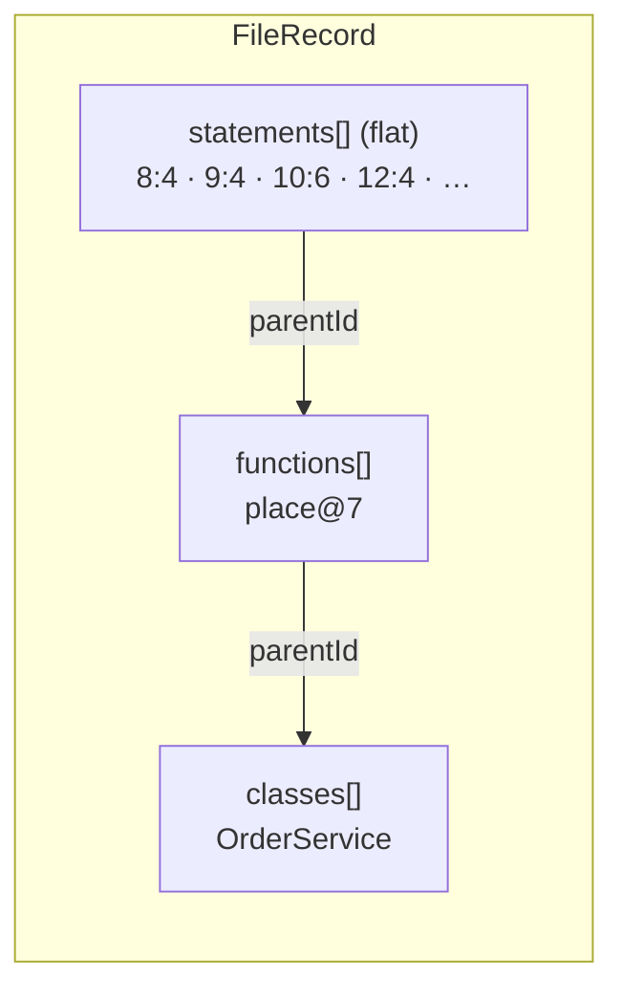
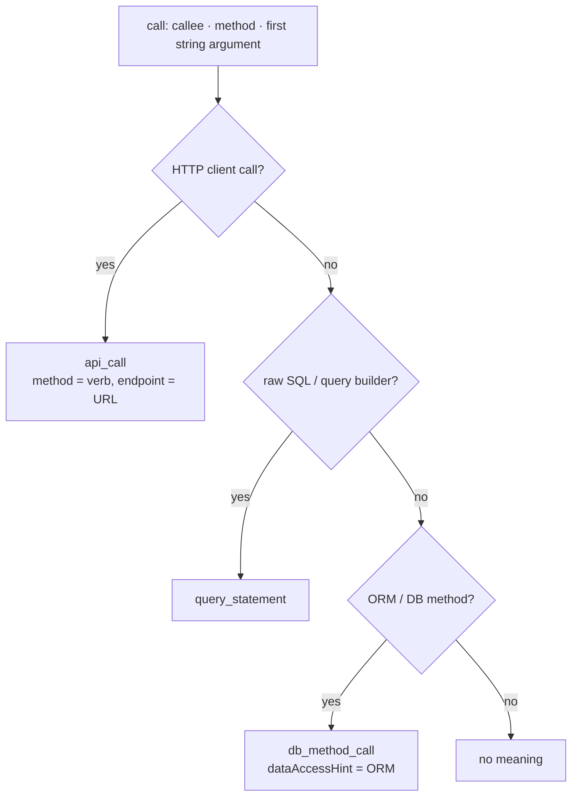
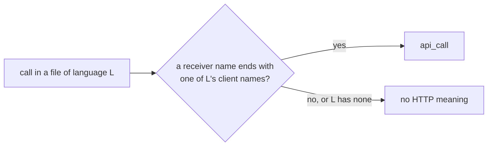
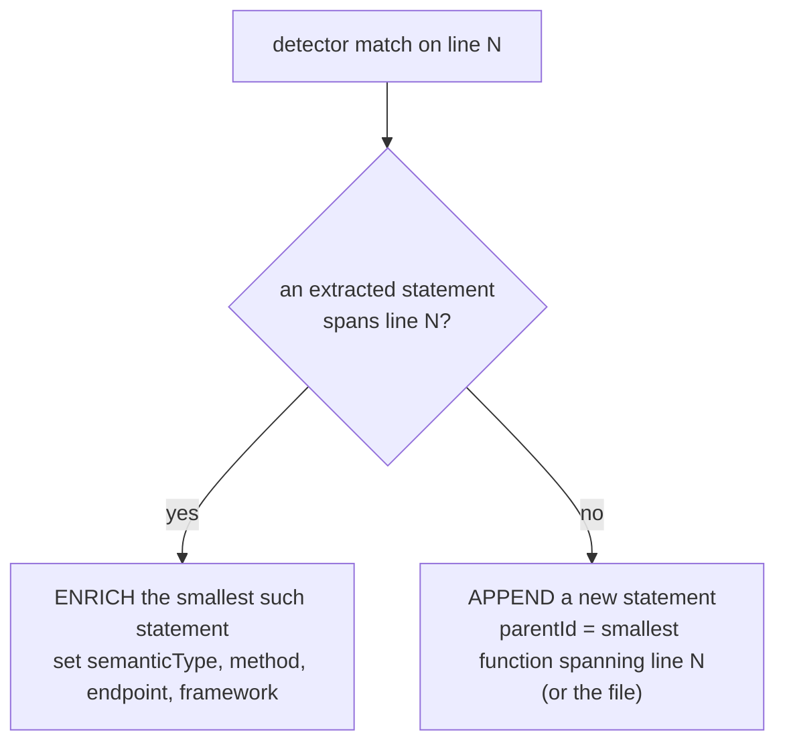

# Statement Model

This page explains how cog turns the inside of a file — the lines within functions, classes and
the file itself — into `Statement` records. It covers what is emitted, how each statement gets
its meaning, how detectors add to it, and how comments, enum members and very large statements
are handled.

It expands [§7 of the architecture doc](../architecture.md#7-the-statement-model). The record
shape is defined in `src/breezeai_cog/schemas/capture.py` (`Statement`) and the `semanticType`
values in `src/breezeai_cog/schemas/enums.py`.

All examples on this page are real cog output (some fields left out for space).

**Contents**

1. [What a statement is](#1-what-a-statement-is)
2. [Which statements are emitted](#2-which-statements-are-emitted)
3. [Giving a statement its meaning](#3-giving-a-statement-its-meaning)
4. [Framework detectors: enrich or append](#4-framework-detectors-enrich-or-append)
5. [Comments](#5-comments)
6. [Enum members](#6-enum-members)
7. [Very large statements](#7-very-large-statements)
8. [Turning statements off](#8-turning-statements-off)
9. [Rules for parser authors](#9-rules-for-parser-authors)

---

## 1. What a statement is

A statement is one unit of code with a line range, linked to the file, class or function that owns
it. Every statement has two types:

| Field | Answers | Always set? | Example |
|---|---|---|---|
| `nodeType` | *What is it syntactically?* — the tree-sitter node type | Yes | `expression_statement`, `if_statement`, `line_comment` |
| `semanticType` | *What does it mean?* | Only when detected | `route`, `api_call`, `db_method_call`, `comment` |

The other fields depend on the meaning:

| Fields | Used by |
|---|---|
| `id`, `parentId`, `nodeType`, `text`, `startLine`, `endLine`, `path` | Every statement |
| `name` | Declarations (`int retries = 3` → `retries`), enum members; an MCP tool's or prompt's name (= `endpoint`), an MCP resource's declared literal name, else its URI |
| `method`, `endpoint`, `framework` | Routes, API calls, events |
| `handler`, `handlerLine`, `handlerPath`, `routeKind`, `isRegex`, `authRequired`, `guards`, `handlerChain`, `requestDTO`, `responseDTO`, `version`, `dataLoaders` | Routes (`handlerChain`: [entry points §5](entry-points.md#5-what-a-binding-records)) |
| `dataAccessHint` | `db_method_call` (which ORM / database) |
| `keyFields` | `graphql_entity` |
| `platform` | `iac_*` |
| `isPartial` | Parts of a split statement ([§7](#7-very-large-statements)) |
| `decorators`, `uiRole` | Declarations that are UI components (`export const X = defineComponent({…})` → `uiRole`), with their decorators |

**`requestDTO` / `responseDTO`.** `requestDTO` is the type name of the request payload as the
code declares it: the body parameter (`@RequestBody`, `@Body()`, a FastAPI body model) or a
GraphQL operation's input argument. `responseDTO` is the type of the response payload as
declared: the response model, the handler's return type, or the GraphQL field type. Both are
the declared type **as written in the source language**, with only the wrappers that are not
payload removed: async results (`Promise<T>`, `Observable<T>`, `Task<T>`, `Mono<T>`,
`CompletableFuture<T>`) and HTTP results (`ResponseEntity<T>`, `ActionResult<T>`, `Ok<T>`,
`Optional<T>`). Everything that is payload stays as written: lists and arrays (`List<OrderDto>`,
`OrderDto[]`, `IEnumerable<X>`, GraphQL `[Order!]!`), nullability (`X?`, `ID!`), pages, maps and
the application's own generics (`Page<X>`, `Map<K, V>`, `ApiResponse<X>`), unions and object
types (`X | null`, `{ url: string }`), built-in types and scalars (`string`, `Int`, `Date`).
Empty when nothing is declared (`any`, `unknown`), or when the declared type carries no payload
(`void`, `Promise<void>`, `IActionResult`, `ResponseEntity<Void>`, JAX-RS / Express `Response`,
`ModelAndView`). A consumer that links a DTO to its class reads the name out of the type
(`List<OrderDto>` → `OrderDto`).

Statements are stored **flat** on `FileRecord.statements`, not nested inside functions or
classes. Nesting is expressed by `parentId` and line ranges.



> **Decision —** flat statements linked by `parentId`.
> **Why:** a flat list is easy to stream, split and load (each statement becomes one
> `HAS_STATEMENT` edge), and detectors can append to it without rebuilding a tree.
> **Cost:** to see "the statements of a function", filter by `parentId`.

> **Decision —** `nodeType` is always a real grammar node type, or the single value `synthetic`.
> **Why:** it stays truthful and checkable against the source. A statement takes the type
> tree-sitter gives the node it sits at — a route read from `@GetMapping` is an `annotation`, one
> read from a Python `@app.get` is a `decorator`, a config entry in a dict is a `pair` — never an
> invented name like `route_annotation`. `synthetic` is only for a statement the host grammar has
> no node for (a whole file, a route given by a file name, a directive the grammar does not
> parse). The meaning goes in `semanticType`.

---

## 2. Which statements are emitted

Each language parser lists three sets in its `mappings.py`:

| Set | Meaning | Java example |
|---|---|---|
| `EMIT_TYPES` | Node types that become statements | declarations, `expression_statement`, `if_statement`, `return_statement`, `throw_statement`… |
| `CONTROL_FLOW` | The control-flow subset of `EMIT_TYPES` | `if_statement`, `for_statement`, `try_statement`, `catch_clause`… |
| `NESTED_SCOPES` | Scopes extracted as their own `Class` / `Function` | `class_declaration`, `method_declaration`, `lambda_expression`… |

The extractor walks the scope and emits every `EMIT_TYPES` node it meets. How it treats nested
scopes depends on where it is:

| Walking… | Nested scopes (classes, methods, lambdas) | Why |
|---|---|---|
| The file root or a class body | **Stops** at them (JS/TS: at those extracted as a `Class` / `Function`, walking into nameless ones — below) | They are extracted as their own `Class` / `Function`, with their own statements. |
| A function body | **Walks into inline lambdas** and gives their statements to the function | A lambda is not a `Function` record, so its statements belong to the enclosing function. |

**Functions without a name of their own.** Each piece of code is recorded once:

- An **inline** function (a callback argument, a `go`/`defer` literal, an array value) is never
  a `Function`. Its statements belong to the enclosing function. In Go and PHP, an inline
  function at the file root gives its statements to the file
  (Laravel `Route::get('/health', function () { return …; })`); in JS/TS too, and one in a
  class field initializer or `static { … }` block gives them to the class (below).
- A function **stored in a variable or class field** (`const save = (x) => …`,
  `var notify = func(msg string) {…}`, `$notify = function ($msg) {…};`,
  `handle = () => {…}`) is one `Function`, named after the variable (`type`
  `arrow_function` or `function_expression`). The declaration that stores it is not emitted
  as a statement, because its text is that Function's code. A declaration that also stores
  something else (`const a = 1, f = () => go();`) is still emitted.
- An arrow function with an **expression body** (`const save = (x) => db.insert(x)`) gets
  that expression as its one statement, with the expression's own `nodeType`
  (`call_expression`), so the call is recorded under the Function.

**JS/TS code outside any function or class.** At file level and in a class's field
initializers and `static { … }` blocks, a function with a name of its own (`setInterval(function
tick() {…})`), or bound to a name in a nameless callback, is a `Function` of the file (or the
class). A function stored where callers find it by name is one too, named there:
`exports.x = …` / `module.exports.x = …` → `x`, `module.exports = …` and an anonymous
`export default` → `default`, `X.prototype.m = …` → `m` with `receiverType` X; never a name
that two places give (`exports.a = exports.b = …`, a target assigned twice). Everything else
there — nameless callbacks included (`process.on('SIGTERM', () => {…})`, `$('#b').click(function
() {…})`) — is the file's or the class's own: its statements are theirs, and its calls are
`File.calls` / `Class.calls` (the shape of `Function.calls`), without `require(…)` (an import)
or a decorator. The body of an anonymous route handler is then the statements inside the route
record's line range ([entry points §5](entry-points.md#anonymous-handlers)).

**Python code outside any function.** A module's own code — top-level statements, `if __name__
== "__main__":`, `with DAG(…):` blocks, module-level lambdas — runs when the module loads; its
calls are `File.calls`. A class body's own code (`repo = Repo()`, `on_done =
staticmethod(lambda r: load(r))`) runs when the class is defined; its calls are `Class.calls`.
Same shape as `Function.calls`, present only when there is one. A `def`'s or nested class's
body is its own, and so are its decorators (`@retry(3)` is in `decorators`, not a call) and
parameter defaults. A module-level local's class is not read for these calls (any function may
rebind it with `global`).

**Java anonymous classes** (`new T(…) { … }`) are a `Class` each (`isAnonymous: true`), with
their methods as `Function`s; the enclosing method keeps only its own statements and calls.

- **Stored in a field** as its whole initializer (`ResponseHandler onError = new ResponseHandler()
  { … };`): named after the field (`Svc.onError`). The `Class` spans the declaration and carries
  its annotations, so the declaration is not also a statement. A declaration that also stores
  something else (`Runnable c = new Runnable() { … }, d = null;`) is still emitted, with the body
  shown as `{ … }`.
- **Anywhere else** (an argument, a `return`, a local variable, part of a larger expression):
  numbered in source order within the named class, `Svc$1`, `Svc$2` (`Svc$1$1` nested). The
  statement that creates it keeps its head, the body shown as `{ … }`.
- The type after `new` is `extends` when it is certainly a class (constructor arguments, or a
  class of this file, the repository — a member type the enclosing class inherits from an
  in-repo ancestor included — or a known JDK type) and `implements` when it is certainly an
  interface; a library type gives neither. When it is a class of another repository file, the
  creating method (or, outside any method, the class) also calls its constructor (`calls`
  entry named after it).

**Java code outside any method** — field initializers, `static { … }` and `{ … }` initializer
blocks, enum constants' arguments — runs when the class loads or an object is built, yet no
`Function` holds it. Its calls are the **class's** (`Class.calls`, the shape of
`Function.calls`: one per name and target file in order of first appearance, present only when
there is one), so
they do not depend on statement capture, and statements never carry calls:
`static { bus.put(A, new WriteHandler()); }` in `ServiceServer` → the `ServiceServer` Class has
`calls: [{name: "put"}, {name: "WriteHandler", path: "…/WriteHandler.java"}]`. An anonymous
class's own initializers (`new HashMap<>() {{ put(…); }}`) are that anonymous Class's calls; a
field-stored anonymous subclass's constructor call (`ResponseHandler onError = new
ResponseHandler() { … }`) is the enclosing class's.
- **An enum constant's body** (`RED("r") { String tag() { … } }`) is an anonymous subclass of
  the enum, as Java compiles it: named after the constant (`Color.RED`), `extends` the enum, its
  methods under it. The constant stays an `enum_member` statement of the enum.

| Code | `Function` | Statements |
|---|---|---|
| `func Run() { r.GET("/x", func(c *gin.Context) { c.JSON(200, list()) }) }` | `Run` | `r.GET(…)` and `c.JSON(200, list())`, both under `Run` |
| `var notify = func(msg string) { send(msg) }` | `notify` (`function_expression`) | `send(msg)` under `notify`; no `var_declaration` statement |
| `const save = (x: string) => db.insert(x);` | `save` (`arrow_function`) | `db.insert(x)` (`call_expression`) under `save`; no `lexical_declaration` statement |

**Example** (Java)

```java
public void place(Order o) {
  int retries = 3; // max attempts
  if (repo.existsById(o.id)) {
    throw new IllegalStateException("dup");
  }
}
```

| `id` | `nodeType` | `text` |
|---|---|---|
| `…:8:4` | `local_variable_declaration` | `int retries = 3; // max attempts` |
| `…:9:4` | `if_statement` | `if (repo.existsById(o.id)) {` |
| `…:10:6` | `throw_statement` | `throw new IllegalStateException("dup");` |

Two details:
- A **control-flow** statement keeps only its header line as `text`, but its line range covers
  the whole body. Its body's statements are emitted on their own.
- A **comment on the same line** as a statement is folded into that statement's `text`
  (`// max attempts` above), so it isn't emitted twice.

---

## 3. Giving a statement its meaning

For each emitted statement, the extractor finds the calls inside its own expression and asks the
shared classifier (`parsers/detection/`, `classify_call`) what each call is:



`method` on an `api_call` is an HTTP verb or empty. A generic `client.request(…)` whose verb
the call does not name (`request(config)`, `request(HttpMethod.valueOf(m), url)`) is an
`api_call` with an empty `method`; where the language parser reads the verb from the arguments
(`requests.request("GET", url)`, `axios({ method: "post" })`) it is that verb. In Java a client
method whose verb is an argument — Vert.x `request` / `requestAbs`, Spring `exchange` /
`execute`, `WebClient.method` — takes a written `HttpMethod.PUT` as its verb; its URL is the
first argument when the verb is not first (`exchange(url, HttpMethod.GET, …)`), else the last
later argument that reads as a path or URL (`request(HttpMethod.PUT, 8080, "host", "/orders")`
→ `/orders`).

`framework` on an `api_call` names the HTTP client, and only from evidence; the shared
classifier matches clients by name, so on its own it leaves `framework` empty. An additive
detector labels the statement afterwards — never adding one — when the file binds the client
and **every** HTTP call in the statement goes through it:

| Client | Evidence in the file | `framework` |
|---|---|---|
| jQuery | jQuery imported or loaded by the page | `jquery` |
| axios | `axios` imported or required, or an instance from its `create(…)`; called as `axios(…)` / `axios.get(…)` / `api.post(…)` | `axios` |
| Fetch API | `fetch(…)` / `window.fetch(…)` / `globalThis.fetch(…)`, with `fetch` bound by nothing in the file or only by an import from a Fetch implementation (`node-fetch`, `cross-fetch`, `undici`, …) | `fetch` |
| Angular `HttpClient` | `this.<field>.get(…)` etc., the field a constructor parameter property, typed field or `inject(…)` of `HttpClient` imported from `@angular/common/http`; or `http.get(…)` on a local bound once to `inject(HttpClient)` or typed `HttpClient` | `angular` |
| Vert.x `HttpClient`, vendor SDKs | the client type | `vertx`, `hubspot`, … |

No evidence — `this.http.get(…)` with no visible type, a wrapper of unknown origin, a name
bound twice or shadowed by a parameter, `Promise.all([axios.get(a), fetch(b)])` — leaves
`framework` empty.

`dataAccessHint` names the product, in order of evidence:
1. **A distinctive method:** `insertOne` → `mongodb`.
2. **The receiver:** `orderRepository.findOne` → `typeorm`. A repository name counts only where it
   ends a name in the receiver chain, as the HTTP client names below do: `this.userRepo`,
   `getRepository(User)` and `repositories.users` are repositories; `reportFile`, `reportService`
   and `repoUrl` are not. A product is named only in a language
   it ships for, so a Java or C# repository call gets the generic `orm`. A Node or Python ORM
   verb, or a Firebase JavaScript SDK verb (`getDocs`, `onSnapshot`), in another language
   (`stream().findFirst()`, a Groovy `paperKit.getDocs()`) needs a data-access receiver too. A
   receiver whose declared type is the product's client counts for that product's generic verbs:
   in a C# file importing the DynamoDB SDK, `_ctx.SaveAsync(order)` on an `IDynamoDBContext` →
   `dynamodb`, while `_cache.SaveAsync(order)` stays an ordinary call. The name is bound where
   the call is: a class that declares its own `_ctx` as something else is not DynamoDB.
   A cache's name is not evidence of a product: `cache.get(key)`, `cacheManager.Set(…)` or
   `HttpRuntime.Cache.Get(…)` is most often in memory, so only a name that says Redis
   (`redisClient.get`) or a Redis verb (`hset`, `lpush`) gives `redis`.
   Django's `objects` manager counts only in Python; elsewhere `objects` is an ordinary name.
   A collection-iteration method whose only argument is a closure (Groovy
   `collection.find { it.id == id }`, `model.findAll { it.enabled }`) filters a list in memory,
   so it is no data access whatever the receiver is called. The parser says when a call's only
   argument is a closure (`classify_statement(closure_only=…)`, Groovy so far), and names inside
   a closure along the call chain are not part of the receiver. A GORM query written with a
   closure (`Book.findAll { author == a }`) is therefore left unrecorded, not guessed.
3. **The file's own ORM import:** where step 2 left `orm` and the receiver is a repository, DAO,
   entity manager or session, the file's import of the ORM's API names it: Hibernate `Session` /
   `SessionFactory` → `hibernate`, JPA `EntityManager` or Spring Data JPA → `jpa`, the
   `NHibernate` namespace → `hibernate`, `Microsoft.EntityFrameworkCore` → `entity_framework`
   (Java, Kotlin, Groovy, Scala, C#, VB). In C# an import made once for the whole project counts
   as the file's own — a `global using` in any `.cs` file of the same project, or
   `<Using Include>` in its `.csproj` / `Directory.Build.props` — as the compiler sees it; another
   project's imports do not. A `jakarta.persistence` annotation or exception is not
   enough: other ORMs (Ebean) use them too. EF's `Include` / `ThenInclude` on a chain naming a
   bundle (`new ScriptBundle("~/x").Include("~/Scripts/x.js")`) is ASP.NET bundling, not a query.
4. **Otherwise `orm`:** data access whose product the file doesn't show. A service that
   receives its repository by injection usually imports only that interface, so it stays `orm`.

The order matters: API is checked first (so Django's `objects.get` is not mistaken for an HTTP
GET only because of its name), and raw queries before ORM calls (so `createNativeQuery("SELECT …")`
is a `query_statement`). `createQuery` is a raw query only with a query string as its argument
(`em.createQuery("select p from Person p")`) or in a file importing JPA or Hibernate (step 3
above): elsewhere the name builds something else, such as a model's `Query.createQuery(key, value)`
or LINQ's `Provider.CreateQuery(expression)`. If no call matches but the statement contains a string with real SQL
structure, it becomes a `query_statement`:

```java
String q = "SELECT id, total FROM orders WHERE id = ?";
```
→ `nodeType: local_variable_declaration`, `semanticType: query_statement`, `name: q`.

### HTTP client names, per language

The HTTP step decides by the receiver's name: a call with an HTTP verb (`get`, `post`, …) whose
receiver names a client. A part of the receiver chain names one when its name **ends with** a
client name that starts a word there, because the last word of a name says what it is:

| Receiver | Client? |
|---|---|
| `dataApiClient`, `new P3APIClient(uri)`, `DefaultHttpClient`, `this._http`, `$http`, `axios.create()` | yes |
| `apiClientPool` (a pool), `HttpRuntime.Cache` (a cache), `httpContextProvider`, `fetched` | no |
| `sky`, `forgot` (`ky` and `got` do not start a word) | no |

Each language reads only its own libraries' names, because the same word is an ordinary name
elsewhere: `session` is Python's `requests.Session`, but in Java it is often a JSON object, so
`session.getString("platformId")` reads a field, and in Groovy a Map.



| Languages | Client names |
|---|---|
| all below | `http`, `httpClient`, `restClient`, `apiClient` |
| JavaScript / TypeScript | `httpService`, `axios`, `fetch`, `superagent`, `got`, `ky`, `ofetch`, `webClient`, and a bare `fetch(…)` |
| Python | `requests`, `session`, `httpx`, `aiohttp`, `urllib`, `urllib3` |
| Java, Kotlin, Groovy, Scala | `restTemplate`, `webClient` |
| C#, VB | `restTemplate` (Spring.NET), `webClient`, and the `HttpClient` verbs `GetAsync`, `GetStringAsync`, `PostAsJsonAsync` … |
| Go | only the shared names |
| Ruby | `HTTParty` |

Some clients are recognised by their imported classes instead of a name. Apache HttpClient
(Java) puts the verb in the request class and sends with a generic `execute`, so the record sits
where the request is built: `new HttpGet(url)`, with `HttpGet` imported from
`org.apache.http.client.methods` (or HttpClient 5's `org.apache.hc.client5.http.classic.methods`),
→ `api_call`, `method: GET`, `endpoint` from `url` when it holds a string. A class of the
repository's own with the same name is not one.

In C# and VB, a receiver ending in `Session` (ASP.NET session state, NHibernate `ISession`) is
never a client, not even `HttpContext.Session`.

### Languages that skip the name match

The HTTP and ORM steps partly decide by the receiver's name (`axios`, `http`, `session`, `repo`).
Some languages have no naming convention to rely on, so they skip those steps and record such
calls only through evidence-based detectors (an import, a declared type). A language with no
client names above skips the HTTP step:

| Language | Skips | Recorded instead by |
|---|---|---|
| PHP | HTTP and ORM | `php/http_calls.py`, `php/data_access.py` |
| Go | ORM | `go_database/access.py` (the receiver's declared type) |
| C, C++ | HTTP and ORM | nothing yet, so they have none |

In C++, `web_http.post("/v1/orders", handler)` registers a server route and `sessions.get(id)` reads
a map; a name match would record both as outbound HTTP calls. Raw SQL detection still applies to
every language, because it needs SQL structure, not a name.

### Several calls in one statement

A statement holds a **single** `semanticType`. When one statement contains several classified
calls, the first goes on the statement itself and each further one gets its own record at the
call's position, with `nodeType` set to the call node:

```ts
await axios.post("/billing/charge", { id }).then(() => prisma.order.update({ where: { id }, data: {} }));
```

| `id` | `nodeType` | `semanticType` | Fields |
|---|---|---|---|
| `orders.ts:8:2` | `expression_statement` | `api_call` | `method: POST`, `endpoint: /billing/charge` |
| `orders.ts:8:57` | `call_expression` | `db_method_call` | `method: update`, `dataAccessHint: prisma` |

### Calls inside a control-flow header

A control-flow statement **never** carries a `semanticType`. A classified call in its header gets
its own record:

```ts
if (await prisma.order.findUnique({ where: { id } })) {
```

| `id` | `nodeType` | `semanticType` |
|---|---|---|
| `orders.ts:5:2` | `if_statement` | — |
| `orders.ts:5:12` | `call_expression` | `db_method_call` (`findUnique`, `prisma`) |

> **Decision —** one meaning per record; extra meanings become extra records.
> **Why:** fields like `method` and `endpoint` stay single-valued, so a query such as
> "all POST calls to /billing" is a simple filter. **Cost:** one line of source can produce
> several records.

> **Decision —** the classifiers are shared and conservative.
> **Why:** the same rules serve every language, so they must not fire on look-alikes
> (`Array.find`, `cache.get`, `"Create account"`). Ambiguous verbs need a positive database
> receiver before they count. **Cost:** some real calls through unusual wrappers are missed.
> A parser can pass the names of known HTTP clients or typed repositories for its file to
> widen recognition safely.

---

## 4. Framework detectors: enrich or append

Detectors that record **entry points** (routes, consumers, schedules) follow the
[entry-point contract](entry-points.md): what is and isn't an entry point, where its record
lives and what `endpoint` must hold.

Framework detectors (routes, event buses, schedulers) run after the language extraction, on the
same tree. A detector never edits `record.statements`: it returns `Emit`s (the node, the fields,
and an `enrich` mode), and `apply` (`parsers/emits.py`) writes them — enriching the smallest
eligible statement on the line, or appending:



**Enrich** (the usual case) — from the Vert.x example in the architecture doc:

```java
vertx.eventBus().publish(ORDERS, ctx.body().asJsonObject());
```
The Java extractor already emitted this as an `expression_statement`. The Vert.x detector sets
`semanticType: eventbus_publish`, `framework: vertx` and `endpoint: orders.created` on that same
record.

**Append** — when no extracted statement exists, for example a call in a lambda used as a field
initialiser (outside any function body), or a route that comes from an annotation:

```java
@GetMapping("/orders/{id}")
public Order get(@PathVariable String id) { … }
```
→ a new record at the annotation with `nodeType: annotation`, `semanticType: route`,
`method: GET`, `endpoint: /orders/{id}`, `handler: get`, parented to the method.

Which statement an emit may enrich is its `enrich` mode:

| `enrich` | May enrich |
|---|---|
| `never` (default) | nothing — always append |
| `unclassified` | a statement with no `semanticType` (or one listed in `reclassify`, a known mis-tag) |
| `own` | an unclassified statement that is exactly the construct's line span |
| `starts` | an unclassified statement that begins on the construct's first line |
| `same` | the statement captured on this very node, whatever its type |
| `any` | whatever statement is there |

An emit that sets `skip` (node types never enriched; the MCP client's `mcp_call` sets the
control-flow statements) finds its statement through the tree instead of by line: the innermost
captured statement that contains the node. When that one is of a `skip` type (the call is in a
control-flow header) or not eligible under its `enrich` mode, the emit is appended. So on a line
with two statements (`x = 1; call()`, `with c as s: call()`) the one the call is in is enriched.

`apply` also gives each appended statement its id (`path:line:col`, disambiguated in emit
order) and its parent, and enriches a statement at most once per run, so a second route in one
statement (`route(p).get(a).post(b)`) gets its own record.

> **Decision —** the detector decides per emit whether it may enrich (`Emit.enrich`, default
> `never`); `apply` is the one place that writes.
> **Why:** one piece of source maps to one record, and ids, parents and "once per run" are
> applied the same way for every detector. **Cost:** an author must choose the mode; the wrong
> one either duplicates a record or overwrites another detector's.

Two further rules apply to detectors:
- **Route emitters skip fixture files** (`*.stories.*`, `mocks/`, `fixtures/`…), whose routers
  are throwaway test set-ups: additive detectors with `Gate(skip_fixtures=True)`, parser-owned
  route code with `is_fixture_file`.
- **Constants are folded** into `endpoint` when they are true compile-time constants (`ORDERS` →
  `orders.created`; a route path `app.get(API + "/orders")` → `/api/orders`) and the file shows
  which constant a name is: it declares it or imports it. A name it does neither for — or reads
  at runtime under the same name — is marked, never filled from another file's constant. See
  [Cross-file resolution §7](cross-file-resolution.md#7-constant-folding).
- **A part read at runtime is marked `${…}`** where it stands, named after its source, never
  guessed, and never written `{name}` (a path parameter): inbound
  `router.get(pathPrefix + "/request")` → `endpoint: ${pathPrefix}/request`; outbound
  `axios.post(config.contextRoot + "/orders/" + id)` → `endpoint: ${config.contextRoot}/orders/{id}`.
  An address left with no named part (`${value}`, `{param}` only) is empty. The full rule is in the
  [entry-point contract §6](entry-points.md#a-part-read-at-runtime-name).

---

## 5. Comments

Comments are captured by **one shared pass** over the whole file (`parsers/comments_common.py`),
the same for every language. Each comment becomes a statement with `semanticType: comment`, and
keeps its real `nodeType` (`comment`, `line_comment`, `block_comment`; a Python docstring is a
`string`).

**Which record owns a comment** — tried in this order:

| Rule | When | Example |
|---|---|---|
| 1. **Bind ahead** | The next declaration starts right after the comment, with no statement in between, inside the same scope | A doc comment above a method is owned by that method |
| 2. **Containment** | Otherwise, the innermost function or class that contains the comment | A note inside a method body |
| 3. **File** | Otherwise | A licence header |

```java
/** Saves an order and notifies billing. */
public void place(Order o) { … }
```
→ `nodeType: block_comment`, `semanticType: comment`, `parentId: …#OrderService#place@7`.

**Not emitted twice.** A comment that is already part of another statement's text (a same-line
trailing comment, or a comment inside a multi-line declaration) is skipped. Consecutive
single-line comments are merged into one record.

> **Decision —** one whole-file comment pass, instead of capturing comments inside each extractor.
> **Why:** the per-scope extractors don't visit every place a comment can be (file root, class
> bodies, comments placed just outside a declaration). One pass based on the line ranges the
> extractor already produced handles all languages the same way, and only needs each
> language's comment node types (`COMMENT_TYPES`).
> **Cost:** one extra tree walk per file. The binding and dedup lookups use tables built once per
> file (sorted starts, a running maximum of span ends, an open-scope stack), never a scan of all
> statements per comment, so the pass stays linear in file size.

---

## 6. Enum members

Each enum member becomes a statement under its enum class, with `semanticType: enum_member`, the
member's name in `name`, and its full source (including any value) in `text`:

```java
enum Status { ACTIVE("A"), CLOSED("C"); … }
```

| `parentId` | `nodeType` | `semanticType` | `name` | `text` |
|---|---|---|---|---|
| `…#OrderService.Status` | `enum_constant` | `enum_member` | `ACTIVE` | `ACTIVE("A")` |
| `…#OrderService.Status` | `enum_constant` | `enum_member` | `CLOSED` | `CLOSED("C")` |

> **Decision —** enum members are statements with an `enum_member` marker, not a list in `Class.metadata`.
> **Why:** a single cross-language filter finds "all enum members", whatever each grammar calls
> them. The enum's body is still treated as its own scope, so methods inside an enum are
> extracted normally. **Cost:** the backend embeds class metadata but not statements, so members
> no longer add to the enum class's semantic-search score. They are still found by label/text
> queries and returned with their class. See [Capture-to-graph mapping](graph-mapping.md).

---

## 7. Very large statements

A statement can be enormous: a generated code blob, a giant string literal, a whole data
document. The backend rejects statements above a size limit, so cog splits them **once, at
output time** (`emit/split.py`), for every parser:

| Rule | Detail |
|---|---|
| Limit | `statement_text_limit` (default 8,000 characters) |
| Split | Into ordered parts; ids get `#part1of3`, `#part2of3`… |
| Where | At a line break inside the window when possible; otherwise a hard cut |
| Flag | Every part has `isPartial: true` |
| Meaning | Only the **first** part keeps `semanticType` and its fields, so one route never becomes three |
| Lossless | Concatenating the parts gives back the original text — unless `max_statement_parts` is set and exceeded, in which case the tail is dropped, a visible `…[+N chars dropped …]` marker is added and a warning is logged |

> **Decision —** split instead of truncate, in one place.
> **Why:** truncation loses the end of the text silently, and having each parser truncate in its
> own way would be inconsistent. **Cost:** a reader must join the parts to see the whole text.

A separate guard protects against generated code with extremely long string concatenations
(`"a" + b + "c" + …`, hundreds of levels deep). When the depth passes `max_concat_depth`
(default 100), cog stops trying to work out an endpoint from it. The statement is still
captured; only its `endpoint` is left empty, and one summary line per file is logged.

---

## 8. Turning statements off

Statement capture is **on by default**. With `--no-capture-statements`
(`BREEZEAI_COG_CAPTURE_STATEMENTS=false`) **no** statements are emitted: no structural statements,
routes, calls, events, comments or enum members. Files, classes, functions, imports and calls
(`calls[]`) are still captured.

> **Decision —** one switch for all statements.
> **Why:** statements are most of a capture's size. Some uses only need the structure, and a
> single switch is easy to reason about. **Cost:** every extractor and detector must respect
> `ctx.capture_statements`.

---

## 9. Rules for parser authors

- Extraction emits statements only through the shared helpers (`classify_statement`,
  `member_statement`, `emit_enum_members`) and the id helpers in `emit`, with one `seen_ids` set
  per file.
- Detectors return `Emit`s and never edit `record.statements`; `apply` writes them. Choose the
  `enrich` mode deliberately ([§4](#4-framework-detectors-enrich-or-append)).
- Check `ctx.capture_statements` before emitting anything (an additive detector's `Gate` does
  it); route emitters skip fixture files (`Gate(skip_fixtures=True)` or `is_fixture_file`).
- Use the real grammar `nodeType` of the node the statement sits at (an annotation or decorator
  has one); `synthetic` only when the host grammar has no node for it. Never invent a node type.
- Never put a `semanticType` on a control-flow statement.
- Reuse an existing `semanticType` where it fits. A new value needs a decision first
  ([Extending Capture §5](../../skills/extend-capture/SKILL.md#5-choosing-how-to-store-what-you-capture)).
- Don't truncate text in the parser; splitting happens at output.

The step-by-step is in the [Parser Reference](../parser-reference.md).
